# TÀI LIỆU ĐẶC TẢ BIỂU ĐỒ LỚP UML (UML CLASS DIAGRAM SPECIFICATION)
**Đề tài:** Hệ thống Tuyển dụng Thông minh – HireSense AI (SIGNAL Edition)  
**Tiêu chuẩn:** Phân tích & Thiết kế Hướng đối tượng (OOAD) theo chuẩn UML 2.5  
**Kiến trúc:** Layered Architecture / Clean Architecture (Controller $\rightarrow$ Service $\rightarrow$ Domain Entity $\rightarrow$ Repository)

---

## 1. TỔNG QUAN KIẾN TRÚC BIỂU ĐỒ LỚP

Hệ thống HireSense AI được thiết kế theo mô hình Hướng đối tượng gồm **18 Lớp Thực thể nghiệp vụ (Domain Entities)**, kết hợp cùng các **Lớp Điều khiển (Controllers)** và **Lớp Dịch vụ (Services)**. Toàn bộ hệ thống được phân chia thành 6 phân hệ cốt lõi:

1. **Phân hệ 1 (Auth & Identity):** `User`, `CandidateProfile`, `Company`, `CompanyMember`
2. **Phân hệ 2 (CV Processing & OCR):** `CV`, `EducationRecord`, `ExperienceRecord`, `Skill`, `CVSkill`
3. **Phân hệ 3 (Job Management & Moderation):** `Job`, `JobSkill`, `JobReport`
4. **Phân hệ 4 (AI Hybrid Matching):** `MatchResult`, `HybridScorer`
5. **Phân hệ 5 (ATS Recruitment Funnel):** `Application`, `Notification`
6. **Phân hệ 6 (Security & Data Privacy):** `AuditLog`, `DataConsent`, `DataRequest`

```mermaid
classDiagram
    direction TB

    %% MODULE 1: AUTH & IDENTITY
    class User {
        +UUID id
        +String email
        -String hashed_password
        +String full_name
        +String phone
        +UserRole role
        +Boolean is_active
        +Boolean is_verified
        +DateTime created_at
        +verify_password(plain_password: String) Boolean
        +has_role(required_role: UserRole) Boolean
        +change_password(new_password: String) Boolean
        +update_profile(data: Dict) void
    }

    class CandidateProfile {
        +UUID id
        +UUID user_id
        +String title
        +String bio
        +String location
        +Float years_of_experience
        +Integer expected_salary
        +String github_url
        +String linkedin_url
        +update_profile(data: Dict) void
        +get_primary_cv() CV
        +calculate_profile_completeness() Integer
    }

    class Company {
        +UUID id
        +String name
        +String slug
        +String logo_url
        +String website
        +String industry
        +String company_size
        +String verification_status
        +is_verified() Boolean
        +verify_company() void
        +get_active_jobs() List~Job~
    }

    class CompanyMember {
        +UUID id
        +UUID company_id
        +UUID user_id
        +MemberRole role
        +DateTime created_at
        +has_admin_permission() Boolean
        +can_post_jobs() Boolean
        +can_review_applications() Boolean
    }

    %% MODULE 2: CV PROCESSING & OCR
    class CV {
        +UUID id
        +UUID candidate_id
        +String file_name
        +String file_url
        +Integer file_size
        +String mime_type
        +Boolean is_primary
        +ExtractionStatus extraction_status
        +JSON parsed_data
        +Vector768 embedding
        +set_as_primary() void
        +is_valid_for_matching() Boolean
        +get_embedding_vector() List~Float~
        +trigger_re_extraction() void
    }

    class EducationRecord {
        +UUID id
        +UUID cv_id
        +String institution
        +String degree
        +String field_of_study
        +String start_date
        +String end_date
        +String gpa
        +get_study_duration_years() Float
        +is_completed() Boolean
    }

    class ExperienceRecord {
        +UUID id
        +UUID cv_id
        +String company_name
        +String job_title
        +String start_date
        +String end_date
        +Boolean is_current
        +String description
        +calculate_duration_months() Integer
        +extract_key_achievements() List~String~
    }

    class Skill {
        +UUID id
        +String name
        +SkillCategory category
        +String normalized_name
        +normalize_name(raw_name: String) String
        +is_hard_skill() Boolean
    }

    class CVSkill {
        +UUID id
        +UUID cv_id
        +UUID skill_id
        +String proficiency_level
        +Float years_of_experience
        +get_proficiency_weight() Float
    }

    %% MODULE 3: JOB MANAGEMENT
    class Job {
        +UUID id
        +UUID company_id
        +UUID creator_id
        +String title
        +JobType job_type
        +String location
        +Integer salary_min
        +Integer salary_max
        +String experience_level
        +JobStatus status
        +Vector768 embedding
        +publish() void
        +close() void
        +is_accepting_applications() Boolean
        +get_required_skills() List~Skill~
    }

    class JobSkill {
        +UUID id
        +UUID job_id
        +UUID skill_id
        +Boolean is_required
        +Float importance_weight
        +calculate_weighted_score() Float
    }

    class JobReport {
        +UUID id
        +UUID job_id
        +UUID reporter_id
        +String reason
        +ReportStatus status
        +String action_taken
        +resolve(action: String, note: String) void
        +dismiss() void
    }

    %% MODULE 4: MATCHING
    class MatchResult {
        +UUID id
        +UUID job_id
        +UUID cv_id
        +UUID application_id
        +Float overall_score
        +Float hard_skills_score
        +Float semantic_score
        +Float experience_score
        +String ai_explanation
        +JSON recommendations
        +compute_hybrid_score() Float
        +generate_explanation() String
        +get_skills_gap_analysis() Dict
    }

    %% MODULE 5: ATS
    class Application {
        +UUID id
        +UUID job_id
        +UUID candidate_id
        +UUID cv_id
        +ApplicationStatus status
        +DateTime interview_time
        +String cover_letter
        +advance_status(new_status: ApplicationStatus) void
        +schedule_interview(time: DateTime, loc: String) void
        +reject_application(feedback: String) void
    }

    class Notification {
        +UUID id
        +UUID user_id
        +String title
        +String message
        +NotificationType type
        +Boolean is_read
        +mark_as_read() void
        +send_push_alert() Boolean
    }

    %% MODULE 6: SECURITY & PRIVACY
    class AuditLog {
        +UUID id
        +UUID user_id
        +String action
        +String target_type
        +String target_id
        +String ip_address
        +DateTime created_at
        +log_event(action: String, target: String) void
    }

    class DataConsent {
        +UUID id
        +UUID user_id
        +String consent_type
        +Boolean granted
        +DateTime granted_at
        +DateTime revoked_at
        +grant_consent() void
        +revoke_consent() void
        +is_active() Boolean
    }

    class DataRequest {
        +UUID id
        +UUID user_id
        +RequestType request_type
        +RequestStatus status
        +DateTime created_at
        +DateTime completed_at
        +execute_data_export() JSON
        +execute_erasure() Boolean
    }

    %% RELATIONSHIPS
    User "1" *-- "0..1" CandidateProfile : owns
    User "1" o-- "0..*" CompanyMember : joins
    Company "1" *-- "0..*" CompanyMember : employs
    Company "1" *-- "0..*" Job : publishes
    User "1" --> "0..*" Job : creates

    CandidateProfile "1" *-- "0..*" CV : manages
    CV "1" *-- "0..*" EducationRecord : contains
    CV "1" *-- "0..*" ExperienceRecord : contains
    CV "1" *-- "0..*" CVSkill : contains
    Skill "1" --> "0..*" CVSkill : categorizes

    Job "1" *-- "0..*" JobSkill : requires
    Skill "1" --> "0..*" JobSkill : specifies
    Job "1" *-- "0..*" JobReport : receives_flag
    User "1" --> "0..*" JobReport : submits

    Job "1" --> "0..*" Application : receives
    User "1" --> "0..*" Application : submits
    CV "1" --> "0..*" Application : attached_in

    Job "1" --> "0..*" MatchResult : target_job
    CV "1" --> "0..*" MatchResult : evaluated_cv
    Application "0..1" --> "1" MatchResult : contextual_match

    User "1" *-- "0..*" Notification : receives
    User "1" *-- "0..*" AuditLog : logs
    User "1" *-- "0..*" DataConsent : grants
    User "1" *-- "0..*" DataRequest : initiates
```

---

## 2. ĐẶC TẢ CHI TIẾT CÁC LỚP THỰC THỂ THEO PHÂN HỆ

### 2.1. Phân hệ 1: Xác thực & Quản lý Danh tính (Auth & Identity)

#### Lớp `User`
- **Ý nghĩa:** Quản lý tài khoản người dùng đăng nhập hệ thống.
- **Thuộc tính:**
  - `+ id: UUID`: Khóa chính định danh duy nhất người dùng.
  - `+ email: String`: Địa chỉ email duy nhất, dùng để xác thực và nhận thông báo.
  - `- hashed_password: String`: Mật khẩu được mã hóa an toàn bằng Argon2id hoặc Bcrypt.
  - `+ full_name: String`: Họ và tên hiển thị.
  - `+ phone: String`: Số điện thoại liên hệ.
  - `+ role: UserRole`: Vai trò người dùng (`candidate`, `recruiter`, `admin`).
  - `+ is_active: Boolean`: Trạng thái tài khoản khả dụng.
  - `+ is_verified: Boolean`: Trạng thái xác minh email thành công.
  - `+ created_at: DateTime`: Thời điểm đăng ký tài khoản.
- **Phương thức:**
  - `+ verify_password(plain_password: String) -> Boolean`: So khớp mật khẩu nhập vào với mã hash.
  - `+ has_role(required_role: UserRole) -> Boolean`: Kiểm tra quyền truy cập tài nguyên.
  - `+ change_password(new_password: String) -> Boolean`: Đổi mật khẩu mới và cập nhật thời gian.
  - `+ update_profile(data: Dict) -> void`: Cập nhật thông tin cơ bản.

#### Lớp `CandidateProfile`
- **Ý nghĩa:** Mở rộng hồ sơ cá nhân cho người tìm việc (`role = candidate`).
- **Thuộc tính:**
  - `+ id: UUID`: Khóa chính hồ sơ.
  - `+ user_id: UUID`: Khóa ngoại tham chiếu `User.id` (quan hệ $1:1$, `ON DELETE CASCADE`).
  - `+ title: String`: Chức danh mục tiêu (ví dụ: Fullstack Developer).
  - `+ bio: String`: Tiểu sử tóm tắt năng lực bản thân.
  - `+ location: String`: Tỉnh/Thành phố sinh sống và làm việc.
  - `+ years_of_experience: Float`: Tổng số năm kinh nghiệm thực tế.
  - `+ expected_salary: Integer`: Mức lương kỳ vọng (VNĐ hoặc USD).
  - `+ github_url: String`: Liên kết hồ sơ mã nguồn GitHub.
  - `+ linkedin_url: String`: Liên kết mạng xã hội nghề nghiệp LinkedIn.
- **Phương thức:**
  - `+ update_profile(data: Dict) -> void`: Cập nhật các trường thông tin hồ sơ.
  - `+ get_primary_cv() -> CV`: Lấy tệp CV mặc định dùng để ứng tuyển nhanh.
  - `+ calculate_profile_completeness() -> Integer`: Tính phần trăm độ hoàn thiện hồ sơ ($0 - 100\%$).

#### Lớp `Company`
- **Ý nghĩa:** Thông tin doanh nghiệp/nhà tuyển dụng trên sàn.
- **Thuộc tính:**
  - `+ id: UUID`: Khóa chính định danh doanh nghiệp.
  - `+ name: String`: Tên công ty.
  - `+ slug: String`: Đường dẫn URL chuẩn SEO thân thiện.
  - `+ logo_url: String`: Đường dẫn tệp logo trên Object Storage.
  - `+ website: String`: Trang web chính thức của công ty.
  - `+ industry: String`: Ngành nghề kinh doanh chính.
  - `+ company_size: String`: Quy mô nhân sự (ví dụ: 50-100 nhân viên).
  - `+ verification_status: String`: Trạng thái xác thực pháp lý (`unverified`, `verified`).
- **Phương thức:**
  - `+ is_verified() -> Boolean`: Kiểm tra công ty đã được Admin duyệt chưa.
  - `+ verify_company() -> void`: Đánh dấu xác thực sau khi đối soát GPKD.
  - `+ get_active_jobs() -> List[Job]`: Truy vấn danh sách tin tuyển dụng đang mở.

#### Lớp `CompanyMember`
- **Ý nghĩa:** Quan hệ liên kết thành viên/nhân viên tuyển dụng vào một doanh nghiệp.
- **Thuộc tính:**
  - `+ id: UUID`: Khóa chính.
  - `+ company_id: UUID`: Tham chiếu `Company.id`.
  - `+ user_id: UUID`: Tham chiếu `User.id`.
  - `+ role: MemberRole`: Phân quyền nội bộ (`owner`, `recruiter`, `interviewer`).
  - `+ created_at: DateTime`: Ngày gia nhập công ty.
- **Phương thức:**
  - `+ has_admin_permission() -> Boolean`: Kiểm tra quyền quản trị công ty.
  - `+ can_post_jobs() -> Boolean`: Kiểm tra quyền đăng tin tuyển dụng.
  - `+ can_review_applications() -> Boolean`: Kiểm tra quyền chấm điểm và đổi trạng thái ứng viên.

---

### 2.2. Phân hệ 2: Xử lý & Trích xuất CV (CV Processing & OCR)

#### Lớp `CV`
- **Ý nghĩa:** Lưu trữ và quản lý bản ghi CV của ứng viên (PDF, DOCX, Ảnh JPG/PNG).
- **Thuộc tính:**
  - `+ id: UUID`: Khóa chính CV.
  - `+ candidate_id: UUID`: Tham chiếu `CandidateProfile.id`.
  - `+ file_name: String`: Tên tệp tin gốc tải lên.
  - `+ file_url: String`: Đường dẫn lưu tệp an toàn (Local Storage / MinIO / S3).
  - `+ file_size: Integer`: Dung lượng tệp tính bằng bytes.
  - `+ mime_type: String`: Định dạng MIME (`application/pdf`, `image/jpeg`...).
  - `+ is_primary: Boolean`: Đánh dấu CV chính dùng để gợi ý việc làm tự động.
  - `+ extraction_status: ExtractionStatus`: Trạng thái trích xuất (`pending`, `processing`, `completed`, `failed`).
  - `+ parsed_data: JSON`: Dữ liệu có cấu trúc trích xuất bởi mô hình Gemini Vision.
  - `+ embedding: Vector[768]`: Vector nhúng ngữ nghĩa tạo bởi mô hình `text-embedding-004`.
- **Phương thức:**
  - `+ set_as_primary() -> void`: Đặt làm CV chính và bỏ chọn các CV khác.
  - `+ is_valid_for_matching() -> Boolean`: Kiểm tra CV đã hoàn tất trích xuất và có embedding hợp lệ chưa.
  - `+ get_embedding_vector() -> List[Float]`: Trả về mảng số thực 768 chiều.
  - `+ trigger_re_extraction() -> void`: Yêu cầu trích xuất lại khi nội dung thay đổi.

#### Lớp `EducationRecord` & `ExperienceRecord`
- **Ý nghĩa:** Chi tiết lịch sử học vấn và kinh nghiệm làm việc được bóc tách từ CV.
- **Phương thức nổi bật:**
  - `EducationRecord.get_study_duration_years()`: Tính thời gian học tập.
  - `ExperienceRecord.calculate_duration_months()`: Tính số tháng làm việc tại một công ty để tổng hợp tổng số năm kinh nghiệm.

#### Lớp `Skill` & `CVSkill`
- **Ý nghĩa:** Từ điển kỹ năng chuẩn hóa và bảng liên kết kỹ năng của ứng viên.
- **Phương thức:**
  - `Skill.normalize_name()`: Chuyển tên thô thành tên chuẩn (ví dụ: `react.js` $\rightarrow$ `React`).
  - `Skill.is_hard_skill()`: Phân loại kỹ năng chuyên môn kỹ thuật hoặc kỹ năng mềm.
  - `CVSkill.get_proficiency_weight()`: Chuyển đổi mức độ thành thạo sang trọng số số học ($0.2 - 1.0$).

---

### 2.3. Phân hệ 3: Quản lý Việc làm & Kiểm duyệt (Job Management & Moderation)

#### Lớp `Job`
- **Ý nghĩa:** Tin đăng tuyển dụng việc làm từ các công ty.
- **Thuộc tính:**
  - `+ id: UUID`: Khóa chính tin tuyển dụng.
  - `+ company_id: UUID`: Tham chiếu công ty đăng tin.
  - `+ creator_id: UUID`: Tham chiếu tài khoản Recruiter tạo tin.
  - `+ title: String`: Tiêu đề vị trí tuyển dụng.
  - `+ job_type: JobType`: Hình thức làm việc (`full_time`, `part_time`, `remote`, `hybrid`).
  - `+ location: String`: Địa điểm làm việc thực tế.
  - `+ salary_min: Integer`: Mức lương tối thiểu.
  - `+ salary_max: Integer`: Mức lương tối đa.
  - `+ experience_level: String`: Cấp bậc yêu cầu (`intern`, `fresher`, `junior`, `mid`, `senior`, `lead`).
  - `+ status: JobStatus`: Trạng thái tin (`draft`, `published`, `closed`, `flagged`).
  - `+ embedding: Vector[768]`: Vector ngữ nghĩa 768 chiều của bản mô tả công việc (JD).
- **Phương thức:**
  - `+ publish() -> void`: Xuất bản tin tuyển dụng công khai cho ứng viên tìm kiếm.
  - `+ close() -> void`: Đóng tin tuyển dụng khi đã đủ nhân sự.
  - `+ is_accepting_applications() -> Boolean`: Kiểm tra tin còn nhận hồ sơ ứng tuyển hay không.
  - `+ get_required_skills() -> List[Skill]`: Lấy danh sách kỹ năng bắt buộc của tin.

#### Lớp `JobSkill` & `JobReport`
- **Ý nghĩa:** Bảng chi tiết yêu cầu kỹ năng và hệ thống báo cáo vi phạm nội dung tin.
- **Phương thức:**
  - `JobSkill.calculate_weighted_score()`: Tính điểm nhân trọng số khi so khớp.
  - `JobReport.resolve()`: Quản trị viên xử lý báo cáo (duyệt xóa hoặc mở khóa tin).

---

### 2.4. Phân hệ 4: Động cơ So khớp AI Hybrid (AI Matching Engine)

#### Lớp `MatchResult`
- **Ý nghĩa:** Lưu trữ kết quả phân tích mức độ phù hợp giữa 1 CV và 1 JD tuyển dụng.
- **Thuộc tính:**
  - `+ id: UUID`: Khóa chính kết quả.
  - `+ job_id: UUID`: Tham chiếu công việc được so sánh.
  - `+ cv_id: UUID`: Tham chiếu hồ sơ ứng viên được so sánh.
  - `+ application_id: UUID`: Tham chiếu hồ sơ nộp (nếu có).
  - `+ overall_score: Float`: Điểm phù hợp tổng thể ($0 - 100\%$).
  - `+ hard_skills_score: Float`: Điểm so khớp kỹ năng chuyên môn cứng (chiếm trọng số $50\%$).
  - `+ semantic_score: Float`: Điểm tương đồng ngữ nghĩa Cosine Similarity qua pgvector (chiếm trọng số $30\%$).
  - `+ experience_score: Float`: Điểm số năm kinh nghiệm và cấp bậc (chiếm trọng số $20\%$).
  - `+ ai_explanation: String`: Lời giải thích khách quan lý do phù hợp/chưa phù hợp do Gemini AI tạo ra.
  - `+ recommendations: JSON`: Danh sách kỹ năng còn thiếu và khóa học gợi ý bổ sung.
- **Phương thức:**
  - `+ compute_hybrid_score() -> Float`: Công thức kết hợp:
    $$\text{Overall} = 0.50 \times \text{HardSkills} + 0.30 \times \text{Semantic} + 0.20 \times \text{Experience}$$
  - `+ generate_explanation() -> String`: Gọi Prompt mẫu tạo văn bản giải thích chi tiết cho ứng viên và nhà tuyển dụng.
  - `+ get_skills_gap_analysis() -> Dict`: Trả về mảng kỹ năng đã khớp và kỹ năng còn thiếu.

---

### 2.5. Phân hệ 5: Phễu Tuyển dụng ATS & Thông báo (ATS Recruitment Funnel)

#### Lớp `Application`
- **Ý nghĩa:** Đại diện cho một lượt nộp hồ sơ ứng tuyển của ứng viên vào vị trí tuyển dụng.
- **Thuộc tính:**
  - `+ id: UUID`: Khóa chính đơn ứng tuyển.
  - `+ job_id: UUID`: Tham chiếu tin tuyển dụng.
  - `+ candidate_id: UUID`: Tham chiếu ứng viên nộp hồ sơ.
  - `+ cv_id: UUID`: Tham chiếu tệp CV được chọn để nộp.
  - `+ status: ApplicationStatus`: Trạng thái trong phễu (`submitted` $\rightarrow$ `reviewing` $\rightarrow$ `shortlisted` $\rightarrow$ `interview` $\rightarrow$ `offered` $\rightarrow$ `rejected`).
  - `+ interview_time: DateTime`: Lịch phỏng vấn đã xếp.
  - `+ cover_letter: String`: Thư giới thiệu của ứng viên.
- **Phương thức:**
  - `+ advance_status(new_status) -> void`: Chuyển đơn sang bước tiếp theo trong phễu ATS.
  - `+ schedule_interview(time, location) -> void`: Thiết lập thời gian và địa điểm phỏng vấn (tự động tạo thông báo).
  - `+ reject_application(feedback) -> void`: Từ chối hồ sơ kèm lý do phản hồi cho ứng viên.

#### Lớp `Notification`
- **Ý nghĩa:** Thông báo thời gian thực gửi tới người dùng (khi có việc mới, trạng thái ứng tuyển đổi, lịch phỏng vấn...).
- **Phương thức:**
  - `+ mark_as_read()`: Đánh dấu thông báo đã đọc.
  - `+ send_push_alert()`: Bắn thông báo realtime qua WebSocket / SSE.

---

### 2.6. Phân hệ 6: Bảo mật, Kiểm toán & Quyền riêng tư Dữ liệu (Security & Privacy)

#### Lớp `AuditLog`
- **Ý nghĩa:** Ghi lại mọi hành vi nhạy cảm (Đăng nhập, xuất dữ liệu CV, xóa ứng viên, phân quyền) phục vụ rà soát an ninh.
- **Thuộc tính:** `user_id`, `action`, `target_type`, `target_id`, `ip_address`, `created_at`.
- **Phương thức:** `log_event()`: Ghi nhận sự kiện bất biến (Append-only).

#### Lớp `DataConsent` & `DataRequest`
- **Ý nghĩa:** Đảm bảo hệ thống tuân thủ **Nghị định 13/2023/NĐ-CP** về Bảo vệ dữ liệu cá nhân tại Việt Nam và tiêu chuẩn **GDPR**:
  - `DataConsent`: Lưu vết sự đồng ý của ứng viên về việc sử dụng AI để phân tích dữ liệu CV.
  - `DataRequest`: Thực thi các quyền cơ bản của chủ thể dữ liệu (DSR): Quyền yêu cầu xóa thông tin (Right to be Forgotten) và Quyền xuất trích xuất toàn bộ dữ liệu cá nhân (Right of Access).

