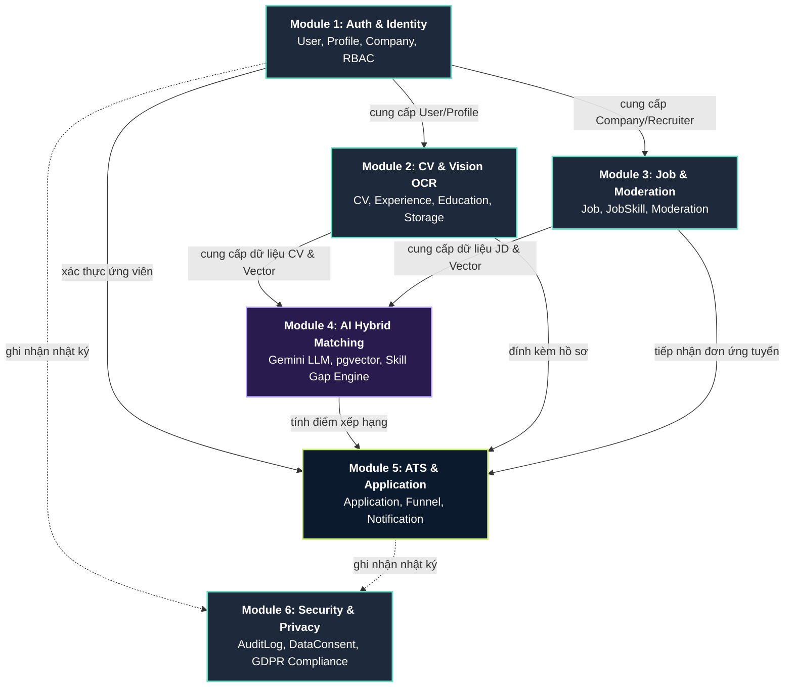
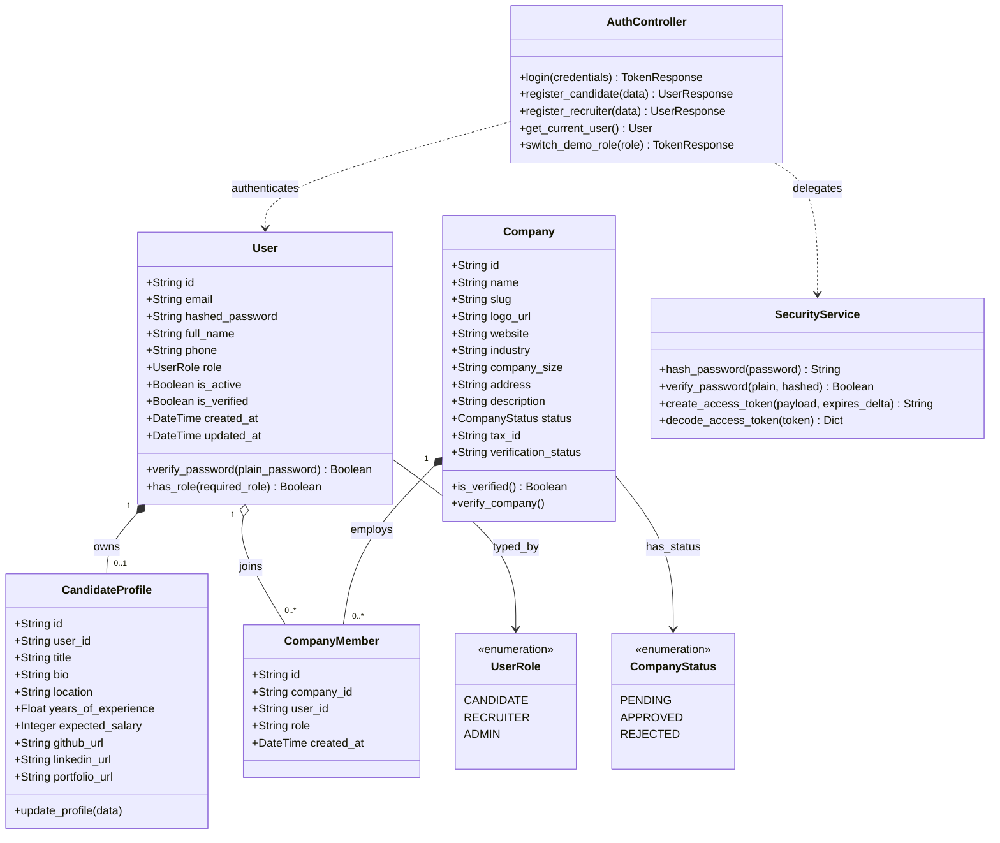
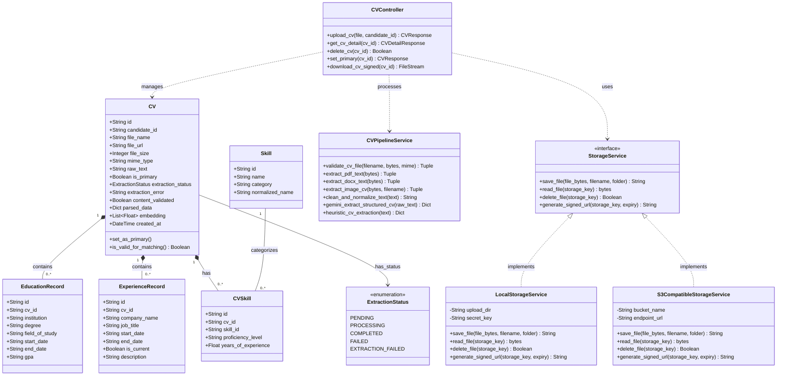
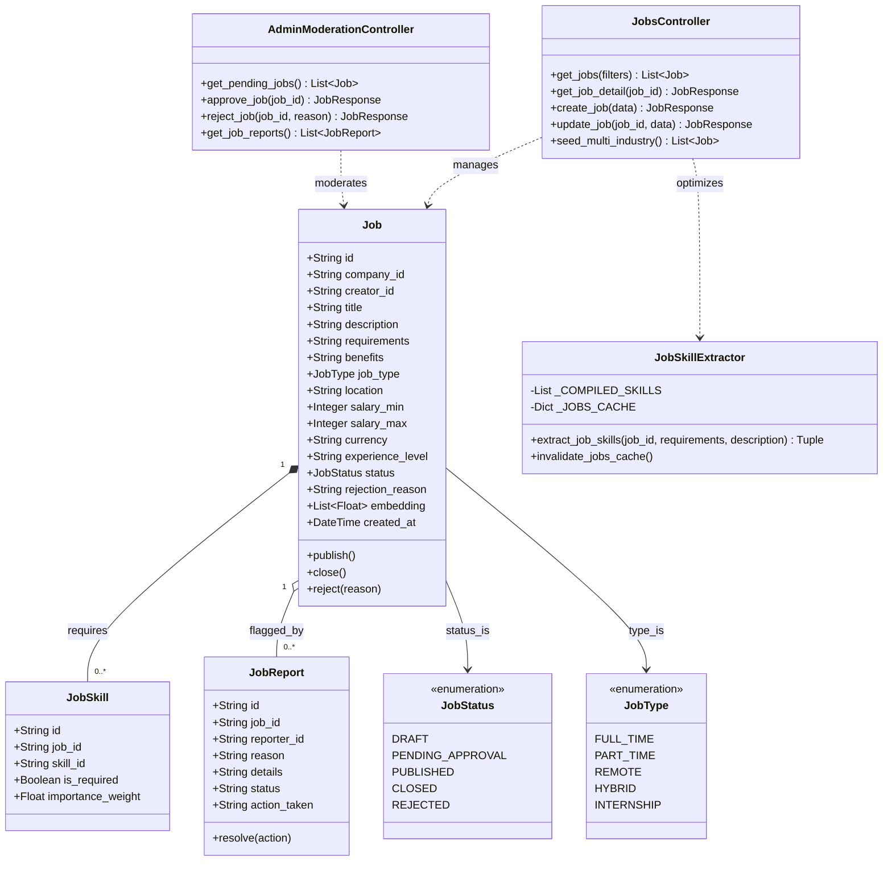
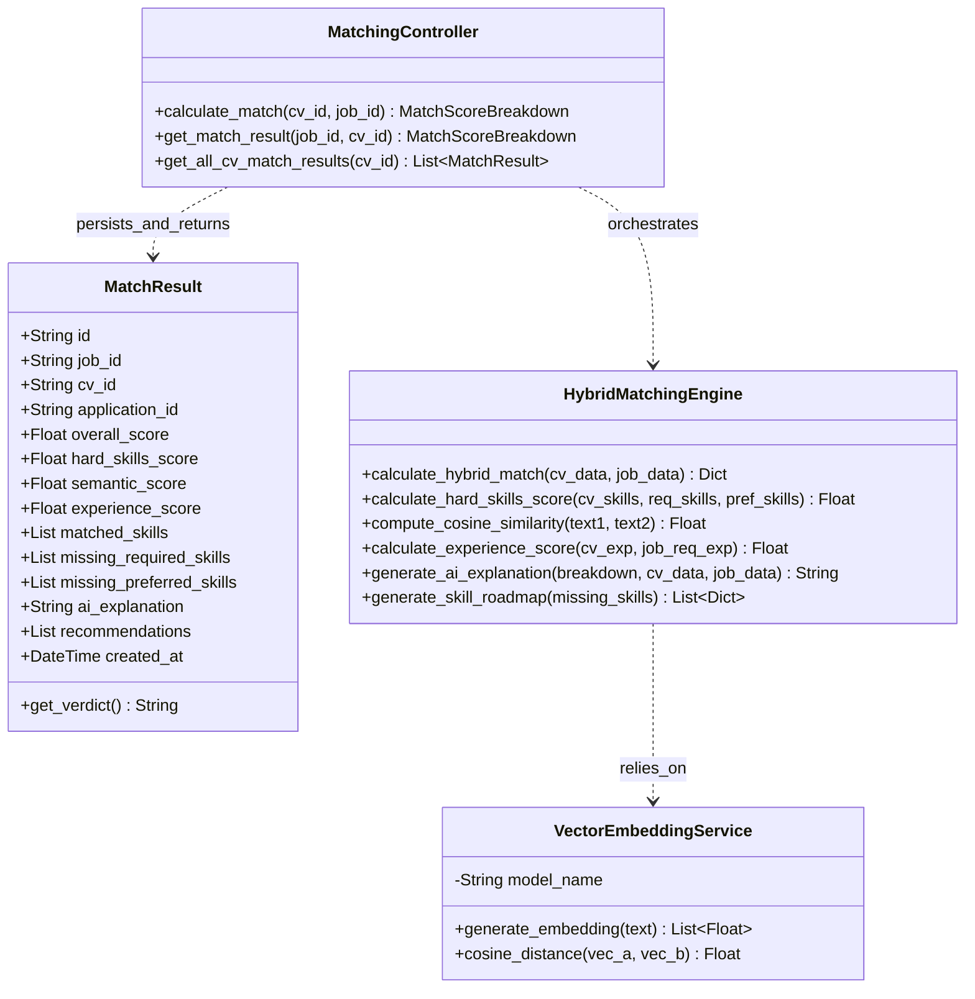
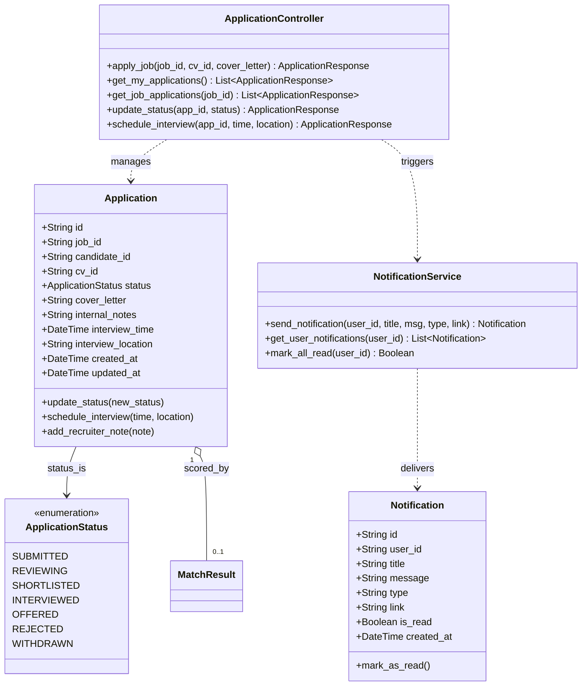
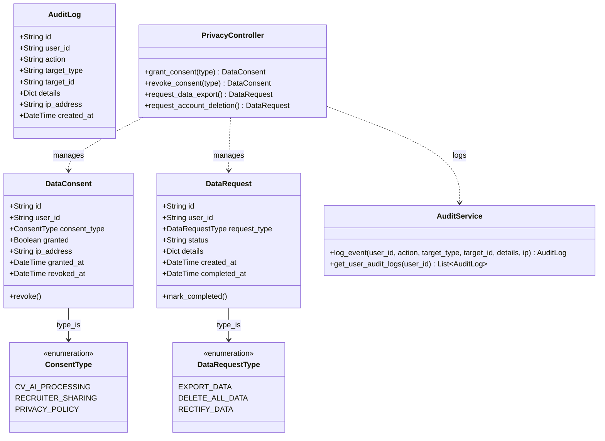

# TÀI LIỆU THIẾT KẾ CƠ SỞ DỮ LIỆU VÀ BIỂU ĐỒ LỚP UML THEO MODULE
**Đề tài:** HireSense AI – Smart Recruitment Platform (SIGNAL Edition)  
**Công nghệ:** PostgreSQL 16 + pgvector, Python FastAPI, SQLAlchemy 2.0 Async, Google Gemini API, ReactJS + TypeScript

---

## 1. SƠ ĐỒ THỰC THỂ LIÊN KẾT CƠ SỞ DỮ LIỆU (DATABASE ERD DIAGRAM)

Cơ sở dữ liệu của HireSense AI gồm **18 bảng thực thể**, hỗ trợ đầy đủ các phân hệ: Xác thực & Phân quyền, Hồ sơ Ứng viên & CV, Tin Tuyển dụng đa ngành, Thuật toán So khớp AI Hybrid Matching, Phễu tuyển dụng, Bảo mật kiểm toán (Audit Logs) và Quyền riêng tư dữ liệu (Data Privacy / GDPR).

```mermaid
erDiagram
    USERS ||--o| CANDIDATE_PROFILES : "owns"
    USERS ||--o{ COMPANY_MEMBERS : "joins"
    USERS ||--o{ JOBS : "creates"
    USERS ||--o{ APPLICATIONS : "submits"
    USERS ||--o{ NOTIFICATIONS : "receives"
    USERS ||--o{ AUDIT_LOGS : "logs"
    USERS ||--o{ DATA_CONSENTS : "grants"
    USERS ||--o{ DATA_REQUESTS : "initiates"
    USERS ||--o{ JOB_REPORTS : "submits"

    COMPANIES ||--o{ COMPANY_MEMBERS : "employs"
    COMPANIES ||--o{ JOBS : "publishes"

    CANDIDATE_PROFILES ||--o{ CVS : "manages"

    CVS ||--o{ EDUCATION_RECORDS : "details"
    CVS ||--o{ EXPERIENCE_RECORDS : "details"
    CVS ||--o{ CV_SKILLS : "contains"
    CVS ||--o{ APPLICATIONS : "attached_to"
    CVS ||--o{ MATCH_RESULTS : "evaluated_in"

    SKILLS ||--o{ CV_SKILLS : "categorizes"
    SKILLS ||--o{ JOB_SKILLS : "categorizes"

    JOBS ||--o{ JOB_SKILLS : "requires"
    JOBS ||--o{ APPLICATIONS : "receives"
    JOBS ||--o{ MATCH_RESULTS : "target_of"
    JOBS ||--o{ JOB_REPORTS : "flagged_by"

    APPLICATIONS ||--o| MATCH_RESULTS : "evaluated_as"

    USERS {
        string id PK "UUID"
        string email "Unique, Index"
        string hashed_password "Argon2 / Bcrypt"
        string full_name "Họ và tên"
        string phone "Số điện thoại"
        string role "candidate | recruiter | admin"
        boolean is_active "Trạng thái kích hoạt"
        boolean is_verified "Đã xác thực email"
        datetime created_at "Thời gian tạo"
        datetime updated_at "Thời gian cập nhật"
    }

    CANDIDATE_PROFILES {
        string id PK "UUID"
        string user_id FK "users.id (Cascade)"
        string title "Chức danh mục tiêu"
        string bio "Giới thiệu bản thân"
        string location "Địa điểm làm việc"
        float years_of_experience "Số năm kinh nghiệm"
        int expected_salary "Mức lương mong muốn"
        string github_url "Link GitHub"
        string linkedin_url "Link LinkedIn"
        string portfolio_url "Website Portfolio"
        datetime created_at "Thời gian tạo"
    }

    COMPANIES {
        string id PK "UUID"
        string name "Tên công ty"
        string slug "Unique, URL slug"
        string logo_url "Đường dẫn logo"
        string website "Website doanh nghiệp"
        string industry "Ngành nghề kinh doanh"
        string company_size "Quy mô nhân sự"
        string address "Địa chỉ trụ sở"
        string description "Mô tả công ty"
        string status "pending | approved | rejected"
        string tax_id "Mã số thuế"
        string verification_status "unverified | verified"
        datetime created_at "Thời gian tạo"
    }

    COMPANY_MEMBERS {
        string id PK "UUID"
        string company_id FK "companies.id"
        string user_id FK "users.id"
        string role "owner | recruiter | interviewer"
        datetime created_at "Thời gian gia nhập"
    }

    CVS {
        string id PK "UUID"
        string candidate_id FK "candidate_profiles.id"
        string file_name "Tên tệp gốc"
        string file_url "Đường dẫn lưu trữ an toàn"
        int file_size "Kích thước tệp (bytes)"
        string mime_type "application/pdf, docx, image"
        text raw_text "Nội dung văn bản trích xuất"
        boolean is_primary "CV chính dùng so khớp"
        string extraction_status "pending | processing | completed | failed"
        text extraction_error "Lỗi trích xuất nếu có"
        boolean content_validated "Đã kiểm duyệt chất lượng"
        json parsed_data "Dữ liệu JSON chuẩn hoá LLM"
        vector_768 embedding "pgvector 768 dimensions"
        datetime created_at "Thời gian tải lên"
    }

    EDUCATION_RECORDS {
        string id PK "UUID"
        string cv_id FK "cvs.id"
        string institution "Tên trường / Học viện"
        string degree "Bằng cấp / Học vị"
        string field_of_study "Chuyên ngành đào tạo"
        string start_date "Thời gian bắt đầu"
        string end_date "Thời gian tốt nghiệp"
        string gpa "Điểm trung bình tích luỹ"
    }

    EXPERIENCE_RECORDS {
        string id PK "UUID"
        string cv_id FK "cvs.id"
        string company_name "Tên công ty"
        string job_title "Chức vụ đảm nhiệm"
        string start_date "Ngày bắt đầu"
        string end_date "Ngày kết thúc"
        boolean is_current "Đang làm việc tại đây"
        text description "Mô tả trách nhiệm & thành tích"
    }

    SKILLS {
        string id PK "UUID"
        string name "Tên kỹ năng (Python, React...)"
        string category "hard | soft | tool | lang"
        string normalized_name "Tên chuẩn hoá NFC"
    }

    CV_SKILLS {
        string id PK "UUID"
        string cv_id FK "cvs.id"
        string skill_id FK "skills.id"
        string proficiency_level "beginner | intermediate | senior | expert"
        float years_of_experience "Số năm áp dụng thực tế"
    }

    JOBS {
        string id PK "UUID"
        string company_id FK "companies.id"
        string creator_id FK "users.id"
        string title "Tiêu đề vị trí tuyển dụng"
        text description "Mô tả công việc"
        text requirements "Yêu cầu ứng viên"
        text benefits "Chế độ đãi ngộ"
        string job_type "full_time | remote | hybrid | part_time"
        string location "Địa điểm tuyển dụng"
        int salary_min "Lương tối thiểu"
        int salary_max "Lương tối đa"
        string currency "VND | USD"
        string experience_level "entry | junior | mid | senior | lead"
        string status "draft | pending_approval | published | closed"
        text rejection_reason "Lý do từ chối kiểm duyệt"
        vector_768 embedding "pgvector 768 dimensions"
        datetime created_at "Thời gian đăng"
    }

    JOB_SKILLS {
        string id PK "UUID"
        string job_id FK "jobs.id"
        string skill_id FK "skills.id"
        boolean is_required "Bắt buộc hay ưu tiên"
        float importance_weight "Trọng số kỹ năng (0.5 - 2.0)"
    }

    APPLICATIONS {
        string id PK "UUID"
        string job_id FK "jobs.id"
        string candidate_id FK "users.id"
        string cv_id FK "cvs.id"
        string status "submitted | reviewing | shortlisted | interviewed | offered | rejected"
        text cover_letter "Thư giới thiệu ứng tuyển"
        text internal_notes "Ghi chú nội bộ của Recruiter"
        datetime interview_time "Lịch hẹn phỏng vấn"
        string interview_location "Phòng phỏng vấn / Link Online"
        datetime created_at "Thời gian nộp đơn"
    }

    MATCH_RESULTS {
        string id PK "UUID"
        string job_id FK "jobs.id"
        string cv_id FK "cvs.id"
        string application_id FK "applications.id (Unique, Nullable)"
        float overall_score "Điểm tổng hợp (0 - 100)"
        float hard_skills_score "Điểm kỹ năng cứng (50%)"
        float semantic_score "Điểm ngữ nghĩa pgvector (30%)"
        float experience_score "Điểm số năm kinh nghiệm (20%)"
        json matched_skills "Danh sách kỹ năng đáp ứng"
        json missing_required_skills "Kỹ năng bắt buộc còn thiếu"
        json missing_preferred_skills "Kỹ năng ưu tiên gợi ý học thêm"
        text ai_explanation "Giải thích lý do chấm điểm của Gemini"
        json recommendations "Lộ trình học tập cá nhân hóa"
        datetime created_at "Thời gian tính toán"
    }

    NOTIFICATIONS {
        string id PK "UUID"
        string user_id FK "users.id"
        string title "Tiêu đề thông báo"
        text message "Nội dung chi tiết"
        string type "application | interview | system"
        string link "Đường dẫn điều hướng"
        boolean is_read "Đã xem thông báo"
        datetime created_at "Thời gian gửi"
    }

    AUDIT_LOGS {
        string id PK "UUID"
        string user_id FK "users.id (Nullable)"
        string action "Hành động thực thi"
        string target_type "Đối tượng chịu tác động"
        string target_id "ID đối tượng"
        json details "Dữ liệu chi tiết thay đổi"
        string ip_address "Địa chỉ IP người thao tác"
        datetime created_at "Thời gian ghi nhật ký"
    }

    DATA_CONSENTS {
        string id PK "UUID"
        string user_id FK "users.id"
        string consent_type "cv_ai_processing | recruiter_sharing"
        boolean granted "Đồng ý xử lý dữ liệu"
        string ip_address "IP khi người dùng xác nhận"
        datetime granted_at "Thời gian chấp thuận"
        datetime revoked_at "Thời gian rút lại chấp thuận"
    }

    DATA_REQUESTS {
        string id PK "UUID"
        string user_id FK "users.id"
        string request_type "export_data | delete_all_data"
        string status "pending | completed | rejected"
        json details "Chi tiết yêu cầu người dùng"
        datetime created_at "Thời gian tạo yêu cầu"
        datetime completed_at "Thời gian xử lý xong"
    }

    JOB_REPORTS {
        string id PK "UUID"
        string job_id FK "jobs.id"
        string reporter_id FK "users.id"
        string reason "scam | fake_company | illegal_fee"
        text details "Chi tiết báo cáo vi phạm"
        string status "pending | reviewed | action_taken"
        string action_taken "Khóa tin / Cảnh cáo"
        datetime created_at "Thời gian báo cáo"
    }
```

---

## 2. BIỂU ĐỒ LỚP UML THEO TỪNG MODULE (MODULAR CLASS DIAGRAMS)

Hệ thống HireSense AI được kiến trúc thành **6 Module chức năng độc lập, lỏng lẻo (loose coupling) và có tính gắn kết cao (high cohesion)**:
1. **Module 1:** Xác thực & Quản lý Danh tính (Auth & Identity Management)
2. **Module 2:** Xử lý & Trích xuất CV Đa phương thức (CV Ingestion & Multi-modal Processing)
3. **Module 3:** Quản lý Tin Tuyển dụng & Kiểm duyệt (Job Management & Moderation)
4. **Module 4:** So khớp Thông minh & Phân tích Kỹ năng (AI Hybrid Matching & Skill Gap Analysis)
5. **Module 5:** Phễu Tuyển dụng & Theo dõi Ứng tuyển (ATS Funnel & Application Tracking)
6. **Module 6:** Bảo mật, Quyền riêng tư & Kiểm toán (Security, Privacy & Audit Logging)

---

### 2.1. Sơ đồ Kiến trúc Phụ thuộc giữa các Module (Package Dependency Diagram)

---

### 2.2. Module 1: Phân hệ Xác thực & Quản lý Danh tính (Auth & Identity Management)

Quản lý đăng ký, đăng nhập JWT, phân quyền 3 vai trò (`Candidate`, `Recruiter`, `Admin`) và thông tin hồ sơ doanh nghiệp.

---

### 2.3. Module 2: Phân hệ Xử lý & Trích xuất CV Đa phương thức (CV Ingestion & Multi-modal Processing)

Tiếp nhận tệp PDF, DOCX hoặc ảnh chụp điện thoại (JPG/PNG/WEBP), giải mã EXIF xoay ảnh, OCR bằng Gemini Vision và trích xuất cấu trúc thực thể. Đồng thời áp dụng **Adapter Pattern** cho việc lưu trữ an toàn.

---

### 2.4. Module 3: Phân hệ Quản lý Tin Tuyển dụng & Kiểm duyệt (Job Management & Moderation)

Quản lý đăng tin 14 lĩnh vực trọng điểm, tự động phân tích từ khóa kỹ năng bằng Regex biên dịch sẵn + LRU Cache, kiểm duyệt tin của Quản trị viên (Admin Moderation).

---

### 2.5. Module 4: Phân hệ So khớp Thông minh & Phân tích Kỹ năng (AI Hybrid Matching & Skill Gap Analysis)

Trái tim trí tuệ nhân tạo của hệ thống: Tính toán điểm tương thích đa tiêu chí kết hợp Trọng số Kỹ năng bắt buộc (50%) + Tương đồng ngữ nghĩa pgvector (30%) + Số năm kinh nghiệm (20%), đồng thời chỉ ra Skill Gap và lộ trình học tập do Gemini sinh ra.

---

### 2.6. Module 5: Phân hệ Tuyển dụng & Quản lý Đơn ứng tuyển (ATS Funnel & Application Tracking)

Quản lý phễu ứng tuyển khép kín: Nộp hồ sơ -> Sàng lọc -> Phỏng vấn -> Nhận việc/Từ chối, kèm theo hệ thống thông báo đẩy (Notification system).

---

### 2.7. Module 6: Phân hệ Bảo mật, Quyền riêng tư & Nhật ký Kiểm toán (Security, Privacy & Audit Logging)

Tuân thủ Nghị định 13/2023/NĐ-CP và GDPR: Ghi vết kiểm toán (Audit Trail), quản lý sự đồng thuận xử lý AI (Data Consent) và quyền yêu cầu xuất/xóa dữ liệu cá nhân (Right to be Forgotten).

---

## 3. BẢNG TỔNG HỢP CÁC MODULE VÀ ÁNH XẠ MÃ NGUỒN THỰC TẾ

| STT | Module | Các Thực thể (Entity Classes) | Services / Pipelines cốt lõi | File mã nguồn Backend chính |
| :---: | :--- | :--- | :--- | :--- |
| **1** | **Auth & Identity** | `User`, `CandidateProfile`, `Company`, `CompanyMember` | `SecurityService`, `AuthService` | [`app/api/v1/endpoints/auth.py`](file:///d:/DACNPM/backend/app/api/v1/endpoints/auth.py), [`app/core/security.py`](file:///d:/DACNPM/backend/app/core/security.py) |
| **2** | **CV & Vision OCR** | `CV`, `EducationRecord`, `ExperienceRecord`, `CVSkill`, `Skill` | `CVPipelineService`, `LocalStorageService`, `S3StorageService` | [`app/api/v1/endpoints/cvs.py`](file:///d:/DACNPM/backend/app/api/v1/endpoints/cvs.py), [`app/ai/pipeline.py`](file:///d:/DACNPM/backend/app/ai/pipeline.py), [`app/core/storage.py`](file:///d:/DACNPM/backend/app/core/storage.py) |
| **3** | **Job & Moderation**| `Job`, `JobSkill`, `JobReport` | `JobSkillExtractor` (LRU + Precompiled Regex) | [`app/api/v1/endpoints/jobs.py`](file:///d:/DACNPM/backend/app/api/v1/endpoints/jobs.py), [`app/api/v1/endpoints/admin.py`](file:///d:/DACNPM/backend/app/api/v1/endpoints/admin.py) |
| **4** | **AI Hybrid Match** | `MatchResult` | `HybridMatchingEngine`, `VectorEmbeddingService` | [`app/api/v1/endpoints/matching.py`](file:///d:/DACNPM/backend/app/api/v1/endpoints/matching.py), [`app/ai/pipeline.py`](file:///d:/DACNPM/backend/app/ai/pipeline.py) |
| **5** | **ATS & Application**| `Application`, `Notification` | `ApplicationService`, `NotificationService` | [`app/api/v1/endpoints/applications.py`](file:///d:/DACNPM/backend/app/api/v1/endpoints/applications.py) |
| **6** | **Security & Privacy**| `AuditLog`, `DataConsent`, `DataRequest` | `AuditService`, `PrivacyService` | [`app/api/v1/endpoints/admin.py`](file:///d:/DACNPM/backend/app/api/v1/endpoints/admin.py), [`app/core/database.py`](file:///d:/DACNPM/backend/app/core/database.py) |

