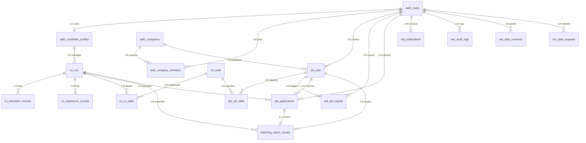

# TÀI LIỆU THIẾT KẾ CƠ SỞ DỮ LIỆU CHI TIẾT (PHYSICAL & LOGICAL DATA DICTIONARY)
**Đề tài:** Hệ thống Tuyển dụng Thông minh – HireSense AI (SIGNAL Edition)  
**Hệ quản trị CSDL:** PostgreSQL 16 + pgvector extension (tương thích hoàn toàn MSSQL Server 2022)  
**Phân vùng Schema:** 6 Schemas nghiệp vụ (`auth`, `cv`, `job`, `matching`, `ats`, `sec`)

---

## 1. SƠ ĐỒ THỰC THỂ LIÊN KẾT TỔNG THỂ (PHYSICAL ERD DIAGRAM)

Cơ sở dữ liệu của HireSense AI được chuẩn hóa ở cấp độ **3NF (Third Normal Form)**, kết hợp kiểu dữ liệu Vector phục vụ tìm kiếm ngữ nghĩa tương đồng và JSONB để linh hoạt lưu trữ cấu trúc CV bóc tách.

---

## 2. TỪ ĐIỂN DỮ LIỆU CHI TIẾT (DATA DICTIONARY)

### 2.1. Phân hệ 1: Xác thực & Quản lý Danh tính (`auth` schema)

#### Bảng 1: `auth.users` (Tài khoản người dùng)
| Tên cột | Kiểu dữ liệu | Ràng buộc | Giá trị mặc định | Giải thích nghiệp vụ |
| :--- | :--- | :--- | :--- | :--- |
| `id` | VARCHAR(36) | **PK** | UUID v4 | Khóa chính duy nhất của người dùng |
| `email` | VARCHAR(255) | **UQ, NOT NULL** | Không | Email đăng nhập, định danh hệ thống |
| `hashed_password` | VARCHAR(255) | **NOT NULL** | Không | Mật khẩu mã hóa Argon2id/Bcrypt |
| `full_name` | VARCHAR(255) | **NOT NULL** | Không | Họ tên đầy đủ của người dùng |
| `phone` | VARCHAR(50) | NULL | NULL | Số điện thoại liên hệ |
| `role` | VARCHAR(50) | **NOT NULL** | `'candidate'` | Vai trò: `'candidate'`, `'recruiter'`, `'admin'` |
| `is_active` | BOOLEAN | **NOT NULL** | `TRUE` | Trạng thái tài khoản hoạt động/bị khóa |
| `is_verified` | BOOLEAN | **NOT NULL** | `FALSE` | Trạng thái kích hoạt qua mã xác thực email |
| `created_at` | DATETIME2 / TIMESTAMPTZ | **NOT NULL** | `CURRENT_TIMESTAMP` | Thời điểm tạo tài khoản |
| `updated_at` | DATETIME2 / TIMESTAMPTZ | **NOT NULL** | `CURRENT_TIMESTAMP` | Thời điểm cập nhật thông tin gần nhất |

#### Bảng 2: `auth.candidate_profiles` (Hồ sơ năng lực ứng viên)
| Tên cột | Kiểu dữ liệu | Ràng buộc | Giá trị mặc định | Giải thích nghiệp vụ |
| :--- | :--- | :--- | :--- | :--- |
| `id` | VARCHAR(36) | **PK** | UUID v4 | Khóa chính hồ sơ ứng viên |
| `user_id` | VARCHAR(36) | **FK, UQ, NOT NULL**| `auth.users(id)` | Liên kết $1:1$ với tài khoản người dùng (`ON DELETE CASCADE`) |
| `title` | VARCHAR(255) | NULL | NULL | Chức danh chuyên môn mục tiêu |
| `bio` | NVARCHAR(MAX) / TEXT | NULL | NULL | Đoạn giới thiệu tóm tắt năng lực cá nhân |
| `location` | VARCHAR(255) | NULL | NULL | Địa bàn sinh sống/làm việc hiện tại |
| `years_of_experience`| FLOAT | NULL | `0.0` | Tổng số năm kinh nghiệm làm việc |
| `expected_salary` | INT | NULL | NULL | Mức lương kỳ vọng (VNĐ/tháng) |
| `github_url` | VARCHAR(255) | NULL | NULL | Liên kết tài khoản GitHub |
| `linkedin_url` | VARCHAR(255) | NULL | NULL | Liên kết mạng xã hội nghề nghiệp LinkedIn |
| `portfolio_url` | VARCHAR(255) | NULL | NULL | Website/Portfolio cá nhân |
| `created_at` | DATETIME2 / TIMESTAMPTZ | **NOT NULL** | `CURRENT_TIMESTAMP` | Thời điểm tạo hồ sơ |
| `updated_at` | DATETIME2 / TIMESTAMPTZ | **NOT NULL** | `CURRENT_TIMESTAMP` | Thời điểm chỉnh sửa hồ sơ |

#### Bảng 3: `auth.companies` (Doanh nghiệp tuyển dụng)
| Tên cột | Kiểu dữ liệu | Ràng buộc | Giá trị mặc định | Giải thích nghiệp vụ |
| :--- | :--- | :--- | :--- | :--- |
| `id` | VARCHAR(36) | **PK** | UUID v4 | Khóa chính doanh nghiệp |
| `name` | VARCHAR(255) | **NOT NULL** | Không | Tên đầy đủ của công ty/tập đoàn |
| `slug` | VARCHAR(255) | **UQ, NOT NULL** | Không | Chuỗi định danh URL thân thiện (SEO slug) |
| `logo_url` | VARCHAR(500) | NULL | NULL | Đường dẫn ảnh thương hiệu công ty |
| `website` | VARCHAR(255) | NULL | NULL | Website chính thức của doanh nghiệp |
| `industry` | VARCHAR(100) | NULL | NULL | Lĩnh vực hoạt động (CNTT, Tài chính...) |
| `company_size` | VARCHAR(50) | NULL | NULL | Quy mô nhân sự (`1-50`, `50-200`, `500+`) |
| `address` | VARCHAR(500) | NULL | NULL | Địa chỉ trụ sở chính |
| `description` | NVARCHAR(MAX) / TEXT | NULL | NULL | Giới thiệu môi trường, văn hóa công ty |
| `status` | VARCHAR(50) | **NOT NULL** | `'approved'` | Trạng thái hiển thị (`pending`, `approved`) |
| `tax_id` | VARCHAR(50) | NULL | NULL | Mã số thuế doanh nghiệp |
| `verification_status`| VARCHAR(50) | **NOT NULL** | `'unverified'`| Trạng thái xác minh (`unverified`, `verified`) |
| `verified_at` | DATETIME2 / TIMESTAMPTZ | NULL | NULL | Thời điểm được Quản trị viên phê duyệt |
| `created_at` | DATETIME2 / TIMESTAMPTZ | **NOT NULL** | `CURRENT_TIMESTAMP` | Thời điểm đăng ký trên sàn |
| `updated_at` | DATETIME2 / TIMESTAMPTZ | **NOT NULL** | `CURRENT_TIMESTAMP` | Thời điểm cập nhật thông tin |

#### Bảng 4: `auth.company_members` (Thành viên nhân sự công ty)
| Tên cột | Kiểu dữ liệu | Ràng buộc | Giá trị mặc định | Giải thích nghiệp vụ |
| :--- | :--- | :--- | :--- | :--- |
| `id` | VARCHAR(36) | **PK** | UUID v4 | Khóa chính |
| `company_id` | VARCHAR(36) | **FK, NOT NULL** | `auth.companies(id)`| Thuộc doanh nghiệp (`ON DELETE CASCADE`) |
| `user_id` | VARCHAR(36) | **FK, NOT NULL** | `auth.users(id)` | Tài khoản tham gia (`ON DELETE CASCADE`) |
| `role` | VARCHAR(50) | **NOT NULL** | `'recruiter'` | Quyền: `'owner'`, `'recruiter'`, `'interviewer'` |
| `created_at` | DATETIME2 / TIMESTAMPTZ | **NOT NULL** | `CURRENT_TIMESTAMP` | Ngày gia nhập |

---

### 2.2. Phân hệ 2: Xử lý & Trích xuất CV (`cv` schema)

#### Bảng 5: `cv.skills` (Từ điển kỹ năng chuẩn hóa)
| Tên cột | Kiểu dữ liệu | Ràng buộc | Giá trị mặc định | Giải thích nghiệp vụ |
| :--- | :--- | :--- | :--- | :--- |
| `id` | VARCHAR(36) | **PK** | UUID v4 | Khóa chính kỹ năng |
| `name` | VARCHAR(100) | **UQ, NOT NULL** | Không | Tên hiển thị kỹ năng (Python, Docker...) |
| `category` | VARCHAR(50) | **NOT NULL** | `'hard'` | Nhóm kỹ năng: `'hard'` hoặc `'soft'` |
| `normalized_name` | VARCHAR(100) | **NOT NULL** | Không | Tên chuẩn hóa chữ thường để truy vấn nhanh |

#### Bảng 6: `cv.cvs` (Tệp và bản ghi CV ứng viên)
| Tên cột | Kiểu dữ liệu | Ràng buộc | Giá trị mặc định | Giải thích nghiệp vụ |
| :--- | :--- | :--- | :--- | :--- |
| `id` | VARCHAR(36) | **PK** | UUID v4 | Khóa chính tệp CV |
| `candidate_id` | VARCHAR(36) | **FK, NOT NULL** | `auth.candidate_profiles(id)` | Thuộc hồ sơ ứng viên (`ON DELETE CASCADE`) |
| `file_name` | VARCHAR(255) | **NOT NULL** | Không | Tên tệp tin gốc người dùng tải lên |
| `file_url` | VARCHAR(500) | **NOT NULL** | Không | Đường dẫn tải tệp mã hóa bảo mật |
| `file_size` | INT | **NOT NULL** | Không | Dung lượng tệp (bytes) |
| `mime_type` | VARCHAR(100) | **NOT NULL** | Không | Kiểu MIME (pdf, docx, jpeg, png) |
| `raw_text` | NVARCHAR(MAX) / TEXT | NULL | NULL | Toàn bộ văn bản thô bóc tách từ OCR |
| `is_primary` | BOOLEAN | **NOT NULL** | `FALSE` | Đánh dấu CV chính dùng để gợi ý tự động |
| `extraction_status` | VARCHAR(50) | **NOT NULL** | `'pending'` | Trạng thái: `'pending'`, `'processing'`, `'completed'`, `'failed'` |
| `extraction_error` | NVARCHAR(MAX) / TEXT | NULL | NULL | Thông báo lỗi nếu trích xuất thất bại |
| `content_validated` | BOOLEAN | **NOT NULL** | `FALSE` | Đã qua bộ lọc kiểm tra nội dung rác |
| `parsed_data` | JSON / JSONB | NULL | NULL | Dữ liệu cấu trúc trích xuất bởi Gemini AI |
| `embedding` | VECTOR(768) / TEXT | NULL | NULL | Vector ngữ nghĩa 768 chiều (`text-embedding-004`) |
| `created_at` | DATETIME2 / TIMESTAMPTZ | **NOT NULL** | `CURRENT_TIMESTAMP` | Thời điểm tải lên |
| `updated_at` | DATETIME2 / TIMESTAMPTZ | **NOT NULL** | `CURRENT_TIMESTAMP` | Thời điểm phân tích gần nhất |

#### Bảng 7: `cv.education_records` (Học vấn)
| Tên cột | Kiểu dữ liệu | Ràng buộc | Giá trị mặc định | Giải thích nghiệp vụ |
| :--- | :--- | :--- | :--- | :--- |
| `id` | VARCHAR(36) | **PK** | UUID v4 | Khóa chính học vấn |
| `cv_id` | VARCHAR(36) | **FK, NOT NULL** | `cv.cvs(id)` | Thuộc về CV (`ON DELETE CASCADE`) |
| `institution` | VARCHAR(255) | **NOT NULL** | Không | Tên trường đại học/cao đẳng/học viện |
| `degree` | VARCHAR(100) | NULL | NULL | Bằng cấp (Cử nhân, Kỹ sư, Thạc sĩ...) |
| `field_of_study` | VARCHAR(255) | NULL | NULL | Chuyên ngành đào tạo |
| `start_date` | VARCHAR(50) | NULL | NULL | Thời gian bắt đầu học |
| `end_date` | VARCHAR(50) | NULL | NULL | Thời gian tốt nghiệp |
| `gpa` | VARCHAR(50) | NULL | NULL | Điểm trung bình tốt nghiệp (GPA) |
| `description` | NVARCHAR(MAX) / TEXT | NULL | NULL | Giải thưởng, học bổng hoặc hoạt động |

#### Bảng 8: `cv.experience_records` (Kinh nghiệm làm việc)
| Tên cột | Kiểu dữ liệu | Ràng buộc | Giá trị mặc định | Giải thích nghiệp vụ |
| :--- | :--- | :--- | :--- | :--- |
| `id` | VARCHAR(36) | **PK** | UUID v4 | Khóa chính kinh nghiệm |
| `cv_id` | VARCHAR(36) | **FK, NOT NULL** | `cv.cvs(id)` | Thuộc về CV (`ON DELETE CASCADE`) |
| `company_name` | VARCHAR(255) | **NOT NULL** | Không | Tên công ty đã từng làm việc |
| `job_title` | VARCHAR(255) | **NOT NULL** | Không | Vị trí/Chức danh công việc đảm nhiệm |
| `start_date` | VARCHAR(50) | NULL | NULL | Tháng/Năm bắt đầu |
| `end_date` | VARCHAR(50) | NULL | NULL | Tháng/Năm kết thúc |
| `is_current` | BOOLEAN | **NOT NULL** | `FALSE` | Đang làm việc tại công ty này |
| `description` | NVARCHAR(MAX) / TEXT | NULL | NULL | Trách nhiệm và thành tích đạt được |

#### Bảng 9: `cv.cv_skills` (Kỹ năng của CV)
| Tên cột | Kiểu dữ liệu | Ràng buộc | Giá trị mặc định | Giải thích nghiệp vụ |
| :--- | :--- | :--- | :--- | :--- |
| `id` | VARCHAR(36) | **PK** | UUID v4 | Khóa chính liên kết |
| `cv_id` | VARCHAR(36) | **FK, NOT NULL** | `cv.cvs(id)` | Thuộc CV (`ON DELETE CASCADE`) |
| `skill_id` | VARCHAR(36) | **FK, NOT NULL** | `cv.skills(id)` | Thuộc từ điển kỹ năng (`ON DELETE CASCADE`)|
| `proficiency_level` | VARCHAR(50) | NULL | NULL | Mức độ thành thạo (`beginner`, `intermediate`, `advanced`) |
| `years_of_experience`| FLOAT | NULL | NULL | Số năm sử dụng kỹ năng |

---

### 2.3. Phân hệ 3: Quản lý Việc làm & Kiểm duyệt (`job` schema)

#### Bảng 10: `job.jobs` (Tin tuyển dụng)
| Tên cột | Kiểu dữ liệu | Ràng buộc | Giá trị mặc định | Giải thích nghiệp vụ |
| :--- | :--- | :--- | :--- | :--- |
| `id` | VARCHAR(36) | **PK** | UUID v4 | Khóa chính tin tuyển dụng |
| `company_id` | VARCHAR(36) | **FK, NOT NULL** | `auth.companies(id)` | Doanh nghiệp tuyển dụng (`ON DELETE CASCADE`)|
| `creator_id` | VARCHAR(36) | **FK, NULL** | `auth.users(id)` | Người đăng bài (`ON DELETE SET NULL`) |
| `title` | VARCHAR(255) | **NOT NULL** | Không | Tiêu đề vị trí tuyển dụng |
| `description` | NVARCHAR(MAX) / TEXT | **NOT NULL** | Không | Bản mô tả công việc (Job Description) |
| `requirements` | NVARCHAR(MAX) / TEXT | **NOT NULL** | Không | Yêu cầu ứng viên (Responsibilities) |
| `benefits` | NVARCHAR(MAX) / TEXT | NULL | NULL | Chế độ đãi ngộ, phúc lợi |
| `job_type` | VARCHAR(50) | **NOT NULL** | `'full_time'` | `'full_time'`, `'part_time'`, `'remote'`, `'internship'` |
| `location` | VARCHAR(255) | **NOT NULL** | Không | Nơi làm việc (Hà Nội, TP.HCM, Remote...) |
| `salary_min` | INT | NULL | NULL | Mức lương tối thiểu (VNĐ) |
| `salary_max` | INT | NULL | NULL | Mức lương tối đa (VNĐ) |
| `currency` | VARCHAR(10) | **NOT NULL** | `'VND'` | Đơn vị tiền tệ giao dịch |
| `experience_level` | VARCHAR(50) | **NOT NULL** | `'mid'` | Cấp bậc: `'intern'`, `'fresher'`, `'junior'`, `'mid'`, `'senior'` |
| `status` | VARCHAR(50) | **NOT NULL** | `'published'` | Trạng thái: `'draft'`, `'published'`, `'closed'`, `'flagged'` |
| `rejection_reason` | NVARCHAR(MAX) / TEXT | NULL | NULL | Lý do từ chối nếu tin bị kiểm duyệt |
| `embedding` | VECTOR(768) / TEXT | NULL | NULL | Vector ngữ nghĩa JD 768 chiều |
| `created_at` | DATETIME2 / TIMESTAMPTZ | **NOT NULL** | `CURRENT_TIMESTAMP` | Ngày đăng tin |
| `updated_at` | DATETIME2 / TIMESTAMPTZ | **NOT NULL** | `CURRENT_TIMESTAMP` | Ngày cập nhật tin |

#### Bảng 11: `job.job_skills` (Yêu cầu kỹ năng công việc)
| Tên cột | Kiểu dữ liệu | Ràng buộc | Giá trị mặc định | Giải thích nghiệp vụ |
| :--- | :--- | :--- | :--- | :--- |
| `id` | VARCHAR(36) | **PK** | UUID v4 | Khóa chính |
| `job_id` | VARCHAR(36) | **FK, NOT NULL** | `job.jobs(id)` | Tham chiếu công việc (`ON DELETE CASCADE`) |
| `skill_id` | VARCHAR(36) | **FK, NOT NULL** | `cv.skills(id)` | Kỹ năng yêu cầu (`ON DELETE CASCADE`) |
| `is_required` | BOOLEAN | **NOT NULL** | `TRUE` | Bắt buộc (`true`) hay Ưu tiên (`false`) |
| `importance_weight` | FLOAT | **NOT NULL** | `1.0` | Trọng số ưu tiên khi tính điểm ($1.0 - 3.0$) |

#### Bảng 12: `job.job_reports` (Báo cáo vi phạm tin tuyển dụng)
| Tên cột | Kiểu dữ liệu | Ràng buộc | Giá trị mặc định | Giải thích nghiệp vụ |
| :--- | :--- | :--- | :--- | :--- |
| `id` | VARCHAR(36) | **PK** | UUID v4 | Khóa chính báo cáo |
| `job_id` | VARCHAR(36) | **FK, NOT NULL** | `job.jobs(id)` | Tin tuyển dụng bị báo cáo |
| `reporter_id` | VARCHAR(36) | **FK, NULL** | `auth.users(id)` | Người gửi khiếu nại |
| `reason` | VARCHAR(100) | **NOT NULL** | Không | Lý do (Lừa đảo, Lương ảo, Sai lệch...) |
| `details` | NVARCHAR(MAX) / TEXT | NULL | NULL | Mô tả chi tiết bằng chứng vi phạm |
| `status` | VARCHAR(50) | **NOT NULL** | `'pending'` | Trạng thái: `'pending'`, `'resolved'`, `'dismissed'` |
| `action_taken` | VARCHAR(100) | NULL | NULL | Biện pháp xử lý của Quản trị viên |
| `created_at` | DATETIME2 / TIMESTAMPTZ | **NOT NULL** | `CURRENT_TIMESTAMP` | Thời gian gửi báo cáo |

---

### 2.4. Phân hệ 4 & 5: So khớp AI & Phễu tuyển dụng ATS (`matching` & `ats` schemas)

#### Bảng 13: `ats.applications` (Hồ sơ ứng tuyển)
| Tên cột | Kiểu dữ liệu | Ràng buộc | Giá trị mặc định | Giải thích nghiệp vụ |
| :--- | :--- | :--- | :--- | :--- |
| `id` | VARCHAR(36) | **PK** | UUID v4 | Khóa chính đơn nộp |
| `job_id` | VARCHAR(36) | **FK, NOT NULL** | `job.jobs(id)` | Tin ứng tuyển (`ON DELETE CASCADE`) |
| `candidate_id` | VARCHAR(36) | **FK, NOT NULL** | `auth.users(id)` | Ứng viên nộp hồ sơ |
| `cv_id` | VARCHAR(36) | **FK, NOT NULL** | `cv.cvs(id)` | Bản CV được chọn để gửi |
| `status` | VARCHAR(50) | **NOT NULL** | `'submitted'` | Phễu: `'submitted'`, `'reviewing'`, `'shortlisted'`, `'interview'`, `'offered'`, `'rejected'` |
| `cover_letter` | NVARCHAR(MAX) / TEXT | NULL | NULL | Thư ngỏ bày tỏ nguyện vọng |
| `internal_notes` | NVARCHAR(MAX) / TEXT | NULL | NULL | Đánh giá nội bộ của Nhà tuyển dụng |
| `interview_time` | DATETIME2 / TIMESTAMPTZ | NULL | NULL | Lịch hẹn phỏng vấn |
| `interview_location`| VARCHAR(255) | NULL | NULL | Địa chỉ phòng phỏng vấn hoặc link Google Meet |
| `created_at` | DATETIME2 / TIMESTAMPTZ | **NOT NULL** | `CURRENT_TIMESTAMP` | Thời điểm nộp đơn |
| `updated_at` | DATETIME2 / TIMESTAMPTZ | **NOT NULL** | `CURRENT_TIMESTAMP` | Thời điểm cập nhật trạng thái |

#### Bảng 14: `matching.match_results` (Kết quả so khớp AI Hybrid)
| Tên cột | Kiểu dữ liệu | Ràng buộc | Giá trị mặc định | Giải thích nghiệp vụ |
| :--- | :--- | :--- | :--- | :--- |
| `id` | VARCHAR(36) | **PK** | UUID v4 | Khóa chính kết quả so khớp |
| `job_id` | VARCHAR(36) | **FK, NOT NULL** | `job.jobs(id)` | Công việc mục tiêu |
| `cv_id` | VARCHAR(36) | **FK, NOT NULL** | `cv.cvs(id)` | CV được chấm điểm |
| `application_id` | VARCHAR(36) | **FK, UQ, NULL** | `ats.applications(id)`| Liên kết đơn nộp (nếu có) |
| `overall_score` | FLOAT | **NOT NULL** | Không | Điểm tổng hợp ($0 - 100$) |
| `hard_skills_score` | FLOAT | **NOT NULL** | `0.0` | Điểm kỹ năng chuyên môn cứng (trọng số $50\%$) |
| `semantic_score` | FLOAT | **NOT NULL** | `0.0` | Điểm Cosine Similarity qua vector (trọng số $30\%$) |
| `experience_score` | FLOAT | **NOT NULL** | `0.0` | Điểm số năm kinh nghiệm & cấp bậc (trọng số $20\%$) |
| `matched_skills` | NVARCHAR(MAX) / TEXT | NULL | NULL | JSON danh sách kỹ năng đã trùng khớp |
| `missing_required_skills`| NVARCHAR(MAX) / TEXT | NULL | NULL | JSON kỹ năng bắt buộc còn thiếu |
| `missing_preferred_skills`| NVARCHAR(MAX) / TEXT | NULL | NULL | JSON kỹ năng khuyến khích còn thiếu |
| `ai_explanation` | NVARCHAR(MAX) / TEXT | NULL | NULL | Đoạn văn giải thích khách quan lý do chấm điểm |
| `recommendations` | JSON / JSONB | NULL | NULL | Khóa học hoặc định hướng phát triển thêm |
| `created_at` | DATETIME2 / TIMESTAMPTZ | **NOT NULL** | `CURRENT_TIMESTAMP` | Thời điểm tính toán kết quả |

#### Bảng 15: `ats.notifications` (Thông báo người dùng)
| Tên cột | Kiểu dữ liệu | Ràng buộc | Giá trị mặc định | Giải thích nghiệp vụ |
| :--- | :--- | :--- | :--- | :--- |
| `id` | VARCHAR(36) | **PK** | UUID v4 | Khóa chính thông báo |
| `user_id` | VARCHAR(36) | **FK, NOT NULL** | `auth.users(id)` | Người nhận thông báo |
| `title` | VARCHAR(255) | **NOT NULL** | Không | Tiêu đề thông báo |
| `message` | NVARCHAR(MAX) / TEXT | **NOT NULL** | Không | Nội dung thông báo |
| `type` | VARCHAR(50) | **NOT NULL** | `'system'` | `'application'`, `'interview'`, `'system'`, `'match'` |
| `link` | VARCHAR(255) | NULL | NULL | Đường link chuyển tiếp khi click |
| `is_read` | BOOLEAN | **NOT NULL** | `FALSE` | Đánh dấu đã đọc/chưa đọc |
| `created_at` | DATETIME2 / TIMESTAMPTZ | **NOT NULL** | `CURRENT_TIMESTAMP` | Thời điểm gửi |

---

### 2.5. Phân hệ 6: Bảo mật, Kiểm toán & Quyền riêng tư (`sec` schema)

#### Bảng 16: `sec.audit_logs` (Nhật ký kiểm toán an ninh)
| Tên cột | Kiểu dữ liệu | Ràng buộc | Giá trị mặc định | Giải thích nghiệp vụ |
| :--- | :--- | :--- | :--- | :--- |
| `id` | VARCHAR(36) | **PK** | UUID v4 | Khóa chính nhật ký |
| `user_id` | VARCHAR(36) | **FK, NULL** | `auth.users(id)` | Người thực hiện (`ON DELETE SET NULL`) |
| `action` | VARCHAR(100) | **NOT NULL** | Không | Hành động (`LOGIN`, `EXPORT_DATA`, `DELETE_CV`...) |
| `target_type` | VARCHAR(100) | NULL | NULL | Đối tượng bị tác động (`User`, `Job`, `Application`) |
| `target_id` | VARCHAR(100) | NULL | NULL | ID của đối tượng bị tác động |
| `details` | NVARCHAR(MAX) / TEXT | NULL | NULL | Chi tiết tham số hoặc payload dữ liệu |
| `ip_address` | VARCHAR(50) | NULL | NULL | Địa chỉ IP của Client thực hiện truy vấn |
| `created_at` | DATETIME2 / TIMESTAMPTZ | **NOT NULL** | `CURRENT_TIMESTAMP` | Thời điểm ghi nhận (Append-only) |

#### Bảng 17: `sec.data_consents` (Ghi nhận chấp thuận dữ liệu cá nhân)
| Tên cột | Kiểu dữ liệu | Ràng buộc | Giá trị mặc định | Giải thích nghiệp vụ |
| :--- | :--- | :--- | :--- | :--- |
| `id` | VARCHAR(36) | **PK** | UUID v4 | Khóa chính |
| `user_id` | VARCHAR(36) | **FK, NOT NULL** | `auth.users(id)` | Chủ thể dữ liệu (`ON DELETE CASCADE`) |
| `consent_type` | VARCHAR(100) | **NOT NULL** | Không | Loại đồng ý (`TERMS_OF_SERVICE`, `AI_MATCHING`, `MARKETING`) |
| `granted` | BOOLEAN | **NOT NULL** | `TRUE` | Chấp thuận (`true`) hoặc Từ chối (`false`) |
| `ip_address` | VARCHAR(50) | NULL | NULL | IP tại thời điểm ký kết |
| `granted_at` | DATETIME2 / TIMESTAMPTZ | **NOT NULL** | `CURRENT_TIMESTAMP` | Thời điểm đồng ý |
| `revoked_at` | DATETIME2 / TIMESTAMPTZ | NULL | NULL | Thời điểm rút lại sự đồng ý |

#### Bảng 18: `sec.data_requests` (Yêu cầu quyền chủ thể dữ liệu - GDPR / Nghị định 13)
| Tên cột | Kiểu dữ liệu | Ràng buộc | Giá trị mặc định | Giải thích nghiệp vụ |
| :--- | :--- | :--- | :--- | :--- |
| `id` | VARCHAR(36) | **PK** | UUID v4 | Khóa chính yêu cầu |
| `user_id` | VARCHAR(36) | **FK, NOT NULL** | `auth.users(id)` | Người yêu cầu (`ON DELETE CASCADE`) |
| `request_type` | VARCHAR(50) | **NOT NULL** | Không | Loại quyền: `'access'`, `'export'`, `'erasure'` (quyền được quên) |
| `status` | VARCHAR(50) | **NOT NULL** | `'pending'` | Trạng thái: `'pending'`, `'processing'`, `'completed'`, `'rejected'` |
| `details` | NVARCHAR(MAX) / TEXT | NULL | NULL | Ghi chú hoặc lý do phản hồi |
| `created_at` | DATETIME2 / TIMESTAMPTZ | **NOT NULL** | `CURRENT_TIMESTAMP` | Ngày khởi tạo yêu cầu |
| `completed_at` | DATETIME2 / TIMESTAMPTZ | NULL | NULL | Ngày hoàn tất xử lý |

---

## 3. THIẾT KẾ CHỈ MỤC HIỆU NĂNG CAO (INDEXING ARCHITECTURE)

| Bảng | Tên Index | Cột được đánh Index | Loại Index | Mục đích tối ưu |
| :--- | :--- | :--- | :--- | :--- |
| `cv.cvs` | `idx_cvs_embedding_hnsw` | `embedding` | **HNSW (`vector_cosine_ops`)** | Tìm kiếm tương đồng vector Cosine dưới 50ms |
| `job.jobs` | `idx_jobs_embedding_hnsw` | `embedding` | **HNSW (`vector_cosine_ops`)** | Semantic Search gợi ý việc làm tức thì |
| `matching.match_results` | `idx_match_job_cv` | `(job_id, cv_id)` | **B-Tree Composite Index** | Truy vấn cache so khớp tránh tính toán lại AI |
| `ats.applications` | `idx_apps_candidate_job` | `(candidate_id, job_id)` | **B-Tree Composite Index** | Kiểm tra ứng viên đã nộp đơn vào vị trí này chưa |
| `auth.users` | `idx_users_email` | `email` | **B-Tree Unique** | Tối ưu thời gian đăng nhập $O(\log N)$ |
| `cv.cvs` | `idx_cvs_candidate_primary` | `(candidate_id, is_primary)` | **B-Tree Partial Index** | Lấy nhanh CV chính của ứng viên khi mở Dashboard |
| `job.jobs` | `idx_jobs_status_created` | `(status, created_at DESC)` | **B-Tree Composite** | Tải danh sách việc làm mới nhất phân trang nhanh |

