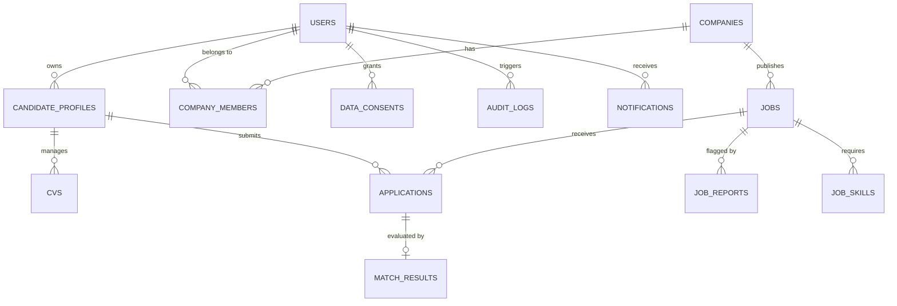

# HireSense AI - Kiến Trúc CSDL & Phân Hệ Lưu Trữ Tệp Tin

**Cơ sở dữ liệu:** PostgreSQL 16 + Tiện ích mở rộng `pgvector` (Vector 768 dimensions)  
**ORM & Migrations:** SQLAlchemy 2.0 Async + Alembic  
**Phân hệ tệp tin:** Hybrid Storage Adapter (`LocalStorageService` with HMAC + `S3CompatibleStorageService`)

---

## 1. Kiến Trúc Mô Hình Dữ Liệu Thực Thể (ERD Overview)



---

## 2. Chiến Lược Đánh Chỉ Mục Tăng Tốc Truy Vấn (Database Indexing)

Nhằm tối ưu hóa tốc độ tải trang dưới 50ms khi lượng bản ghi tăng trưởng cao trong môi trường thương mại:

| Bảng CSDL | Cột được đánh chỉ mục (Index) | Kiểu Index | Mục đích sử dụng |
| :--- | :--- | :--- | :--- |
| `jobs` | `(status, created_at)` | B-Tree Hợp phần | Tăng tốc độ lọc tin việc làm trang chủ và khám phá |
| `jobs` | `company_id` | B-Tree | Tối ưu hóa truy vấn tin của từng doanh nghiệp |
| `jobs` | `embedding` | HNSW / IVFFlat | Tìm kiếm vector tương đồng ngữ nghĩa siêu tốc với pgvector |
| `applications` | `(job_id, status)` | B-Tree Hợp phần | Xếp hạng và phân loại ứng viên tức thì cho nhà tuyển dụng |
| `cvs` | `candidate_id` | B-Tree | Tải danh sách CV cá nhân trong vòng < 5ms |
| `audit_logs` | `(created_at, action)` | B-Tree | Tra cứu lịch sử bảo mật và phục vụ kiểm toán hệ thống |
| `notifications` | `(user_id, is_read)` | B-Tree | Đếm số lượng thông báo chưa đọc (Unread badge) tức thì |

---

## 3. Phân Hệ Lưu Trữ Tệp Tin Trừu Tượng Hóa (Storage Adapter Pattern)

HireSense AI áp dụng Design Pattern **Storage Adapter** (`app/core/storage.py`) cho phép chuyển đổi linh hoạt giữa lưu trữ cục bộ và lưu trữ đám mây qua biến cấu hình môi trường:

```python
# Cấu hình tại .env:
STORAGE_BACKEND=local    # hoặc 's3'
S3_BUCKET_NAME=hiresense-cv-vault
S3_ENDPOINT_URL=https://s3.ap-southeast-1.amazonaws.com # hoặc Cloudflare R2
```

### Cơ chế Bảo Mật HMAC Signed URLs:
- File CV không bao giờ được phục vụ qua đường dẫn trực tiếp tĩnh (public static path) để ngăn chặn việc thu thập dữ liệu trái phép.
- Khi người dùng hoặc nhà tuyển dụng yêu cầu tải CV, hệ thống sinh ra chữ ký điện tử HMAC-SHA256 có thời hạn (15 phút):
  $$\text{Signature} = \text{HMAC-SHA256}(\text{SECRET\_KEY}, \text{storage\_key} + \text{expiry\_timestamp})$$
- Endpoint `GET /api/v1/cvs/download/{storage_key}?expires=...&sig=...` kiểm tra chữ ký và thời hạn trước khi truyền dòng dữ liệu.

---

## 4. Kịch Bản Sao Lưu & Khôi Phục Dữ Liệu Tự Động (DevOps SRE)

Tại thư mục `backend/scripts/`, hai công cụ chuyên dụng đã được lập trình sẵn sàng:

1. **`backup_db.py`:**
   - Thực hiện lệnh `pg_dump` nén nhị phân an toàn.
   - Tự động sinh mã băm SHA-256 Checksum (`.sha256`) cho tệp sao lưu.
   - Tự động xóa các bản sao lưu cũ vượt quá chính sách lưu trữ (Retention Policy: 30 ngày).
2. **`restore_db.py`:**
   - Đọc tệp `.sql` hoặc `.dump` và kiểm tra đối chiếu mã SHA-256 Checksum trước khi khôi phục để loại trừ nguy cơ tệp bị lỗi hoặc can thiệp mã độc.
   - Thiết lập giao dịch an toàn (Atomic Transaction) giúp khôi phục hoàn chỉnh CSDL mà không gây treo hệ thống.

