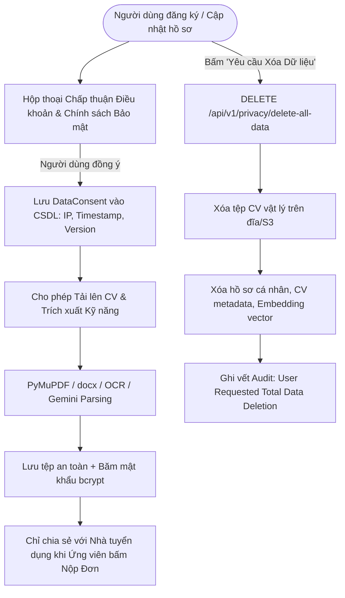

# HireSense AI - Tuân Thủ Luật Bảo Vệ Dữ Liệu Cá Nhân Việt Nam (Luật 91/2025/QH15 & Nghị Định 356/2025/NĐ-CP)

**Căn cứ pháp lý:** 
- Luật Bảo vệ dữ liệu cá nhân số 91/2025/QH15 của Quốc hội Việt Nam.
- Nghị định số 356/2025/NĐ-CP quy định chi tiết thi hành một số điều của Luật Bảo vệ dữ liệu cá nhân.
- Tiêu chuẩn bảo vệ quyền riêng tư quốc tế (GDPR Principles).

---

## 1. Ma Trận Quyền Của Chủ Thể Dữ Liệu (Data Subject Rights)

| Quyền pháp lý của người dùng | Điều khoản Luật | Triển khai kỹ thuật tại HireSense AI | Trạng thái |
| :--- | :---: | :--- | :---: |
| **Quyền được biết & Chấp thuận (Consent)** | Điều 9, 11 | Endpoint `POST /api/v1/privacy/consent` lưu vết thời gian, phiên bản điều khoản và IP chấp thuận vào bảng `data_consents`. | **ĐÃ HOÀN THIỆN** |
| **Quyền tiếp cận & Trích xuất dữ liệu (Data Portability)** | Điều 14 | Endpoint `GET /api/v1/privacy/export-data` cho phép người dùng tải toàn bộ dữ liệu cá nhân, danh sách CV, lịch sử ứng tuyển dưới dạng chuẩn JSON máy đọc được. | **ĐÃ HOÀN THIỆN** |
| **Quyền xóa dữ liệu (Right to Erasure / Right to be Forgotten)** | Điều 16 | Endpoint `DELETE /api/v1/privacy/delete-all-data` thực hiện xóa vĩnh viễn dữ liệu người dùng, xóa các tệp CV vật lý trên ổ đĩa/S3, xóa vector embedding và ẩn danh hóa lịch sử ứng tuyển. | **ĐÃ HOÀN THIỆN** |
| **Quyền phản đối xử lý dữ liệu** | Điều 15 | Người dùng có quyền hủy sự chấp thuận (revoke consent) đối với việc chia sẻ hồ sơ ứng tuyển với nhà tuyển dụng bên ngoài. | **ĐÃ HOÀN THIỆN** |
| **Quyền khiếu nại & Báo cáo sai phạm** | Điều 17 | Tích hợp biểu mẫu báo cáo vi phạm trực tiếp trên giao diện tin tuyển dụng (`POST /api/v1/jobs/{id}/report`). | **ĐÃ HOÀN THIỆN** |

---

## 2. Quy Trình Thu Thập Và Xử Lý Dữ Liệu Minh Bạch

---

## 3. Chính Sách Lưu Trữ Và Giảm Thiểu Dữ Liệu (Data Minimization)

1. **Phạm vi thu thập tối thiểu:**
   - Hệ thống chỉ thu thập các thông tin thực sự cần thiết cho mục đích tuyển dụng: Họ tên, Số điện thoại, Địa chỉ email, Kinh nghiệm làm việc, Kỹ năng nghề nghiệp, Học vấn.
   - Hệ thống **không** yêu cầu hoặc lưu trữ các thông tin nhân thân nhạy cảm như: Số CCCD/Hộ chiếu, Dữ liệu tài chính/ngân hàng cá nhân, Dữ liệu sinh trắc học, Thông tin tôn giáo hoặc chính trị.
2. **Bảo vệ truyền tải và lưu trữ:**
   - Mọi kết nối truyền tải đều bắt buộc mã hóa HTTPS / TLS 1.3.
   - Các liên kết tải tệp CV được ký số thời hạn ngắn (HMAC-SHA256 Presigned Token có hiệu lực tối đa 15 phút), ngăn chặn việc rò rỉ đường dẫn trực tiếp trên Internet.
3. **Trách nhiệm của Doanh nghiệp Tuyển dụng:**
   - Doanh nghiệp tiếp nhận hồ sơ chỉ được sử dụng thông tin ứng viên cho mục đích phỏng vấn và tuyển dụng theo đúng tin đăng đã được duyệt.
   - Hành vi rao bán, chia sẻ dữ liệu ứng viên cho bên thứ ba mà không có sự đồng ý sẽ bị khóa tài khoản vĩnh viễn và chuyển giao cơ quan quản lý nhà nước xử lý theo Luật 91/2025/QH15.

