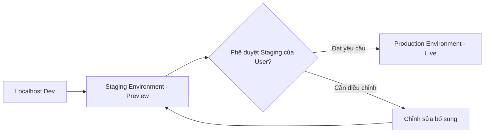

# HireSense AI - Kế Hoạch Triển Khai & Quy Trình Phát Hành Hệ Thống

**Mục tiêu:** Thiết lập quy trình phát hành chuyên nghiệp từ Staging sang Production, đảm bảo không có gián đoạn dịch vụ (Zero-Downtime) và có kịch bản khôi phục (Rollback) an toàn.

---

## 1. Phân Chia Môi Trường (Environment Architecture)

| Tiêu chí | Môi trường Staging | Môi trường Production |
| :--- | :--- | :--- |
| **Mục đích** | Kiểm thử chấp nhận (UAT), QA nội bộ | Phục vụ người dùng thực tế tại Việt Nam |
| **Database** | PostgreSQL Staging (dữ liệu mẫu) | Managed PostgreSQL Cloud + Daily Backup |
| **Storage** | Local disk hoặc S3 Bucket Staging | S3 Bucket Production (AWS / Cloudflare R2) |
| **Demo Mode** | Có thể bật (`VITE_ENABLE_DEMO_MODE=true`) | **Bắt buộc tắt (`VITE_ENABLE_DEMO_MODE=false`)** |
| **Tên miền** | `staging.hiresense.ai` / `*-staging.onrender.com` | `hiresense.ai` / `app.hiresense.ai` |
| **Chứng chỉ số** | Tự động Let's Encrypt SSL/TLS | Cloudflare Enterprise / Strict SSL TLS 1.3 |

---

## 2. Danh Mục Biến Môi Trường Bắt Buộc (Environment Variables Checklist)

### 2.1. Backend (`.env.production`)
- `ENVIRONMENT=production`
- `DEBUG=False`
- `SECRET_KEY=<chuỗi-ngẫu-nhiên-tối-thiểu-64-ký-tự>`
- `DATABASE_URL=postgresql+asyncpg://<user>:<password>@<db-host>:5432/<db-name>`
- `GEMINI_API_KEY=<khóa-api-chính-thức-từ-google-cloud-console>`
- `GEMINI_MODEL=gemini-1.5-flash`
- `BACKEND_CORS_ORIGINS=["https://hiresense.ai","https://app.hiresense.ai"]`
- `STORAGE_BACKEND=s3`
- `S3_BUCKET_NAME=hiresense-production-vault`
- `S3_ACCESS_KEY=<aws-access-key>`
- `S3_SECRET_KEY=<aws-secret-key>`
- `S3_REGION=ap-southeast-1`

### 2.2. Frontend (`.env.production`)
- `VITE_API_URL=https://api.hiresense.ai`
- `VITE_ENABLE_DEMO_MODE=false`

---

## 3. Quy Trình Triển Khai Không Gián Đoạn (Zero-Downtime Deployment)

1. **Bước 1 - Pre-flight Checks:**
   - Chạy toàn bộ test suite (`pytest backend/tests/`).
   - Chạy `npm --prefix frontend run build` kiểm tra bundle.
2. **Bước 2 - Database Migration:**
   - Chạy lệnh sao lưu CSDL tự động: `python backend/scripts/backup_db.py`.
   - Chạy Alembic migration: `alembic upgrade head`.
3. **Bước 3 - Rolling Update Service:**
   - Khởi động container Backend mới.
   - Nginx hoặc Reverse Proxy kiểm tra endpoint `/health`. Khi trả về `status: healthy`, chuyển hướng lưu lượng mạng sang container mới.
   - Hủy container cũ.
4. **Bước 4 - Frontend Static Sync:**
   - Đẩy thư mục `dist/` lên CDN (Cloudflare / CloudFront) hoặc static hosting.
   - Xóa bộ nhớ đệm CDN (Purge Cache) cho tệp `index.html`.

---

## 4. Kịch Bản Khôi Phục Khẩn Cấp (Emergency Rollback Plan)

Trong trường hợp phát hiện lỗi phát sinh sau khi triển khai:
1. **Frontend Rollback:** Chuyển routing CDN quay lại bản build trước đó (thời gian khôi phục: < 30 giây).
2. **Backend Rollback:** Chuyển Reverse Proxy lưu lượng về image container trước.
3. **Database Rollback:**
   - Nếu lỗi do migration: `alembic downgrade -1`.
   - Nếu CSDL bị lỗi cấu trúc nghiêm trọng: Chạy `python backend/scripts/restore_db.py --file <backup_path>` để phục hồi trạng thái snapshot ngay trước khi release.

