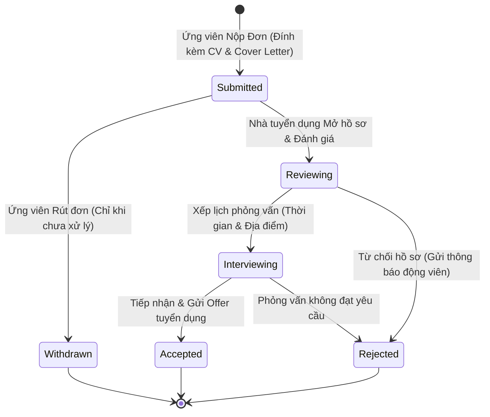

# HireSense AI - Báo Cáo Quy Trình Nghiệp Vụ Tuyển Dụng Thương Mại

**Phạm vi:** Toàn bộ vòng đời ứng tuyển từ Đăng tin $\to$ Ứng tuyển $\to$ Sàng lọc AI $\to$ Phỏng vấn $\to$ Tiếp nhận, đi kèm quy trình An toàn & Tin cậy (Trust & Safety).

---

## 1. Vòng Đời Đơn Ứng Tuyển Thương Mại (Application Lifecycle)

---

## 2. Các Nghiệp Vụ Thương Mại Trọng Tâm Được Bổ Sung

### 2.1. Rút Đơn Ứng Tuyển (Application Withdrawal)
- **Quyền hạn:** Dành riêng cho Ứng viên (Candidate).
- **Điều kiện:** Đơn ứng tuyển đang ở trạng thái `submitted` (chưa chuyển sang `reviewing`).
- **Hành vi hệ thống:**
  - Cập nhật trạng thái sang `withdrawn`.
  - Gửi thông báo tự động cho Nhà tuyển dụng: *"Ứng viên [Tên] đã rút đơn ứng tuyển vị trí [Tên vị trí]"*.
  - Cho phép ứng viên nộp lại sau nếu thay đổi quyết định hoặc cập nhật CV mới.

### 2.2. Xếp Lịch Phỏng Vấn (Interview Scheduling)
- **Quyền hạn:** Dành riêng cho Nhà tuyển dụng (Recruiter).
- **Dữ liệu đầu vào:**
  - `interview_time`: Thời gian phỏng vấn (định dạng ISO 8601).
  - `interview_location`: Địa điểm gặp mặt trực tiếp hoặc đường link họp trực tuyến (Google Meet / Zoom / MS Teams).
- **Hành vi hệ thống:**
  - Tự động cập nhật trạng thái đơn sang `interviewing`.
  - Tạo thông báo in-app cho Ứng viên kèm mốc thời gian và vị trí phỏng vấn.

### 2.3. Hệ Thống Thông Báo Thời Gian Thực (In-App Notification Center)
- Người dùng nhận thông báo tức thì về mọi cập nhật quan trọng:
  - Khi hồ sơ được nộp thành công.
  - Khi trạng thái ứng tuyển thay đổi (Được xem, Được mời phỏng vấn, Tiếp nhận hoặc Từ chối).
  - Khi tin tuyển dụng có ứng viên mới đăng ký.
- Tích hợp số đếm chưa đọc (Unread badge count) và thao tác Đánh dấu đã đọc (`PUT /notifications/{id}/read`).

---

## 3. Quy Trình Bảo Đảm An Toàn & Chống Lừa Đảo (Trust & Safety Engine)

Nhằm bảo vệ ứng viên trước các hành vi lừa đảo tuyển dụng tinh vi (nạp tiền làm nhiệm vụ, cọc tiền mua đồng phục, tuyển dụng giả mạo):

### 3.1. Xác Minh Doanh Nghiệp (Company Verification)
- Khi nhà tuyển dụng đăng ký, hồ sơ công ty được khởi tạo ở trạng thái `pending_verification`.
- Quản trị viên hệ thống (Admin) thực hiện đối chiếu Mã số thuế (MST) và Giấy phép kinh doanh với Cổng thông tin Quốc gia về Đăng ký Doanh nghiệp.
- Khi được phê duyệt, công ty sẽ nhận được huy hiệu **Doanh nghiệp đã xác minh (Verified Company Badge)** trên trang chủ và chi tiết tin đăng.

### 3.2. Bộ Lọc Phát Hiện Lừa Đảo Tự Động (Heuristic Anti-Scam Filter)
- Tích hợp tại `backend/app/core/scam_detector.py`.
- Tự động quét nội dung JD khi nhà tuyển dụng bấm Tạo tin tuyển dụng (`POST /api/v1/jobs`).
- Các dấu hiệu nghi vấn bao gồm:
  - Yêu cầu đặt cọc, nạp tiền, ứng trước tiền hồ sơ/đồng phục.
  - Dụ dỗ chuyển tiếp sang Telegram, Zalo kín để "làm nhiệm vụ kiếm hoa hồng".
  - Hứa hẹn mức thu nhập bất thường phi thực tế (ví dụ: *"việc nhẹ lương 50 triệu/tháng không cần bằng cấp"*).
- **Hành động tự động:** Tin tuyển dụng bị chuyển vào diện cách ly kiểm duyệt (`quarantined / pending_approval`) và cảnh báo gửi ngay về bảng điều khiển của Admin.

### 3.3. Cơ Chế Báo Cáo Vi Phạm Bởi Cộng Đồng (Job Reporting)
- Mọi ứng viên đều có thể bấm nút "Báo cáo tin tuyển dụng đáng ngờ" trực tiếp tại trang chi tiết JD.
- Admin xem xét lý do báo cáo và có quyền hạ tin tức thì bằng 1 click (`PUT /api/v1/admin/reports/{id}/action`).

